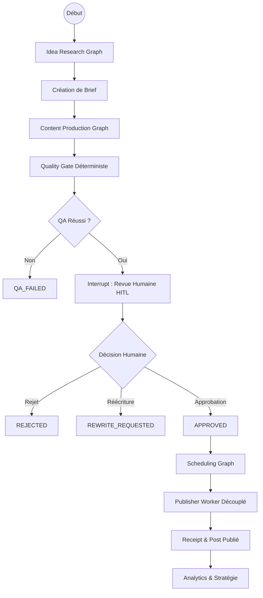

# 🚀 ContentOps Harness — Governed Agentic Editorial Operating System

> **Système d'exploitation éditorial agentique gouverné basé sur LangGraph, FastAPI, PostgreSQL/Supabase et Next.js.**  
> *Transforme de la veille, des notes et des retours d'expérience en contenus multi-plateformes fiables, soumis à validation humaine obligatoire (HITL) et audités en continu.*

---

## 📋 Table des Matières
- [Vue d'Ensemble](#-vue-densemble)
- [Principes Clés & Non-Objectifs](#-principes-clés--non-objectifs)
- [Architecture & Machine à États](#-architecture--machine-à-états)
- [Structure du Projet](#-structure-du-projet)
- [Installation & Démarrage](#-installation--démarrage)
- [Interface Web & Dashboard](#-interface-web--dashboard)
- [API REST & Documentation](#-api-rest--documentation)
- [Suite de Tests & Évaluations (80 Cas)](#-suite-de-tests--évaluations-80-cas)
- [Gouvernance & Sécurité (ADR)](#-gouvernance--sécurité-adr)

---

## 🌟 Vue d'Ensemble

ContentOps Harness n'est pas un simple autoposteur. C'est un **système d'exploitation éditorial** conçu pour garantir qu'aucune publication publique n'intervienne sans une décision humaine explicite, vérifiée cryptographiquement.

### Résultats Métier :
- **Réduction du temps de cycle** : de l'idée/source au brouillon validable en quelques secondes.
- **Cohérence de marque absolue** : respect strict des piliers, du ton et des sujets interdits.
- **Intégrité factuelle** : tout claim technique ou statistique est lié à une source vérifiable avec score de confiance.
- **Idempotence & Zéro doublon** : chaque publication est scellée par une clé d'idempotence unique.
- **Apprentissage propositionnel** : recommandations stratégiques humaines basées sur la performance sans mutation automatique des règles de marque.

### 🚫 Non-Objectifs du MVP :
- ❌ Aucune publication autonome sans validation humaine.
- ❌ Pas de réponses automatiques aux commentaires ou messages privés.
- ❌ Aucune manipulation de l'engagement (pas de bots, ni follow/unfollow).
- ❌ Aucun token ou clé d'API sociale accessible aux prompts de génération.

---

## 🎨 Architecture & Machine à États

Le pipeline éditorial suit un workflow déterministe **LangGraph** avec interruption native pour la revue humaine :



### Machine à États :
```text
IDEA ➔ BRIEFED ➔ DRAFT ➔ QA_FAILED / IN_REVIEW
IN_REVIEW ➔ REWRITE_REQUESTED ➔ DRAFT
IN_REVIEW ➔ REJECTED ➔ ARCHIVED
IN_REVIEW ➔ APPROVED ➔ SCHEDULED ➔ PUBLISHING
PUBLISHING ➔ PUBLISHED / PUBLISH_FAILED
PUBLISHED ➔ MEASURED ➔ ARCHIVED
```

---

## 📁 Structure du Projet

```text
DeepAgent/
├── apps/
│   ├── api/                     # Passerelle FastAPI, RBAC, endpoints REST
│   └── web/                     # Interface Web moderne (Dashboard, Inbox, Calendrier)
├── packages/
│   ├── domain/                  # Entités, machine à états, calculs d'idempotence
│   ├── contracts/               # Schémas Pydantic stricts et événements de domaine
│   ├── prompts/                 # Prompts versionnés (v1.0.0) et registre
│   ├── connectors/              # Connecteurs Tavily, LinkedIn, X, RSS, extracteur
│   └── observability/           # Censure PII, tracing Langfuse, métriques de tokens
├── services/
│   ├── orchestration/           # 8 Graphes LangGraph et nœuds d'agents
│   ├── publisher/               # Worker de publication déterministe
│   └── scheduler/               # Dispatcher de file de publication
├── infra/
│   ├── db/                      # Modèles SQLAlchemy, session et repository
│   ├── migrations/              # DDL SQL pour PostgreSQL/Supabase et RLS
│   └── docker/                  # Dockerfile et docker-compose
├── evals/
│   ├── datasets/                # Dataset de régression de 80 cas
│   └── evaluators/              # Moteur d'évaluation automatisé
├── tests/
│   ├── unit/                    # Tests unitaires (machine à états, QA, idempotence)
│   ├── contract/                # Validation des contrats et événements
│   ├── integration/             # Exécution et interruptions LangGraph
│   ├── e2e/                     # Pipeline de bout-en-bout complet
│   └── security/                # Injections, inviolabilité de hash, RLS
├── docs/                        # Architecture, 6 ADRs, 3 runbooks, guide de marque
├── langgraph.json               # Définition des graphes pour LangGraph CLI/Cloud
├── pyproject.toml               # Configuration du projet et dépendances
└── requirements.txt             # Dépendances Python
```

---

## ⚡ Installation & Démarrage

### 1. Activer l'Environnement Virtuel
```bash
source .venv/bin/activate
```

### 2. Installer les Dépendances
```bash
pip install -r requirements.txt
```

### 3. Configurer l'Environnement
Copier le fichier `.env.example` vers `.env` et ajuster vos paramètres :
```bash
cp .env.example .env
```

### 4. Démarrer le Serveur API & Dashboard Web
```bash
python -m uvicorn apps.api.main:app --host 0.0.0.0 --port 8000 --reload
```

---

## 💻 Interface Web & Dashboard

Une fois le serveur lancé, accédez directement au tableau de bord interactif :
👉 **[http://localhost:8000/ui](http://localhost:8000/ui)**

### Modules inclus dans l'interface :
1. **Vue d'ensemble** : KPI de performance (impressions, taux d'engagement, volume de posts).
2. **Boîte de Validation (HITL Inbox)** : Révision des brouillons avec surlignage des claims vérifiés, contrôle du hash SHA-256 du payload, actions d'approbation / modification / rejet.
3. **Calendrier Éditorial** : Visualisation chronologique des publications programmées et historiques avec liens vers les receipts.
4. **Idéation & Veille** : Générateur de 10+ idées scorées et conversion instantanée en briefs.
5. **Stratégie & Insights** : Recommandations formulées selon le principe de propositionnalité (ADR 6).
6. **Profil de Marque** : Consultation et ajustement des directives éditoriales versionnées.

---

## 🔒 Sécurité & Mode Sandbox

> [!IMPORTANT]
> **AVERTISSEMENT FORMEL DE SÉCURITÉ** :
> - Ne commitez **JAMAIS** de fichiers `.env` réels, de clés d'API (Google, Langfuse, Tavily) ou de jetons OAuth dans ce dépôt.
> - Par défaut, `SOCIAL_SANDBOX_MODE=true` et `LIVE_PUBLISHING_ENABLED=false` sont actifs pour prévenir tout envoi externe involontaire.
> - Toutes les requêtes sensibles et jetons d'accès OAuth sont chiffrés en base de données via AES-256-GCM.
> - Consultez notre politique de divulgation dans [SECURITY.md](SECURITY.md).

---

## 🔌 API REST & Documentation

L'API interactive OpenAPI Swagger est accessible sur :
👉 **[http://localhost:8000/docs](http://localhost:8000/docs)**

### Principales commandes de l'API :
```http
POST /v1/ideas/research               # Déclenche la recherche et le scoring d'idées
POST /v1/briefs                       # Crée un brief éditorial
POST /v1/content/generate             # Produit les variantes et exécute le Quality Gate
GET  /v1/inbox                        # Récupère les brouillons en attente de revue
POST /v1/content/{variant_id}/approve # Valide/Rejette une variante avec intégrité de hash
POST /v1/content/{variant_id}/rewrite # Déclenche une réécriture agentique avec feedback humain
POST /v1/publications/schedule        # Programme la publication avec clé d'idempotence
POST /v1/publications/{job_id}/publish-now # Déclenche le Publisher Worker
GET  /v1/calendar                     # Retourne le calendrier complet
GET  /v1/analytics/overview           # Statistiques globales
POST /v1/strategy/insights            # Génère les hypothèses et recommandations
POST /v1/oauth/test-connection/{p}    # Teste les connecteurs sociaux en temps réel
```

---

## 🧪 Suite de Tests & Évaluations (154 Tests)

### 1. Tests Backend Pytest (133 Tests)
```bash
pytest -v
```
*Couverture : 133 tests automatisés couvrant Sécurité P0 (JWT, RBAC, IDOR/BOLA, injection de prompt, OAuth PKCE Vault, masquage d'erreurs), Fiabilité P0 (Checkpointer persistant, Machine à états, Idempotence, Degraded Mode, LLM Resilience, Kill-switch, At-Most-Once), Qualité (Règles déterministes, 90d duplicate, AI Act), Observabilité & Coûts (Cache LLM, Correlation ID, Pricing externe), et Connecteurs Sociaux.*

### 2. Tests Frontend Vitest (21 Tests)
```bash
cd apps/web && npm run test && cd ../..
```
*Couverture : 21 tests de composants et contextes React (AuthContext, ToastContext, Button, Badge, PlatformPreview).*

### 3. Exécuter l'Évaluation Qualité sur Dataset Versionné
```bash
python evals/evaluators/quality_evaluator.py
```
*Dataset : `evals/datasets/golden_evaluation_dataset.json` et `eval_dataset_80.json` sans aucun faux résultat positif.*

---

## 📄 Licence & Gouvernance

- **Licence** : Publié sous licence open-source [MIT License](LICENSE).
- **Politique de Sécurité** : [SECURITY.md](SECURITY.md).
- **Guide de Contribution** : [CONTRIBUTING.md](CONTRIBUTING.md).
- **Gouvernance & Décisions d'Architecture** :
  - [ADR 0001 : Workflow Déterministe](docs/adr/0001-workflow-first.md)
  - [ADR 0002 : LangGraph Durable & HITL](docs/adr/0002-langgraph-durable-orchestration.md)
  - [ADR 0003 : Séparation du Publisher Worker](docs/adr/0003-separated-publisher-worker.md)
  - [ADR 0004 : PostgreSQL Source de Vérité](docs/adr/0004-postgres-source-of-truth.md)
  - [ADR 0005 : Versionnage des Prompts & Profils](docs/adr/0005-versioned-prompts-and-brand-profiles.md)
  - [ADR 0006 : Apprentissage Propositionnel](docs/adr/0006-propositional-learning.md)
