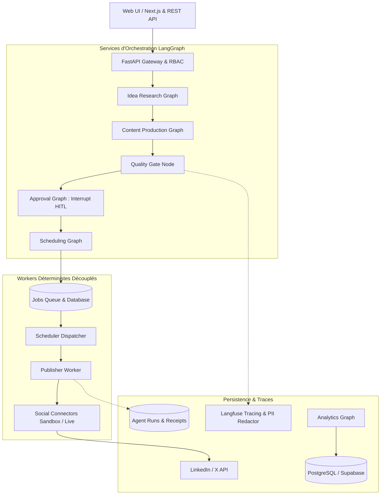

# Architecture de Référence — ContentOps Harness

**Produit :** Content Operations Harness  
**Version :** 1.0  
**Auteur :** Martial Gninhi  

---

## 1. Principes Directeurs d'Ingénierie

1. **Workflow déterministe avant multi-agent libre** : Les opérations éditoriales et les publications publiques sont critiques. Aucun modèle de langage ne dispose d'un accès direct aux credentials de réseaux sociaux.
2. **Human-in-the-loop (HITL) persistant et non contournable** : Un graphe LangGraph interrompt obligatoirement l'exécution (`interrupt_before=["human_review"]`) avant toute étape de publication.
3. **Traçabilité et intégrité cryptographique** : Une décision d'approbation est irrévocablement scellée à un hash SHA-256 du contenu exact. Toute modification ultérieure invalide l'approbation.
4. **Idempotence stricte** : Chaque publication possède une clé d'idempotence dérivée de :  
   `hash(workspace_id, variant_id, platform, scheduled_at, version)`
5. **Apprentissage propositionnel** : Les métriques génèrent des hypothèses d'optimisation formulées à destination d'un décideur humain, sans modifier automatiquement les règles de la marque.

---

## 2. Diagramme d'Architecture Globale



---

## 3. Machine à États du Contenu

Le cycle de vie du contenu est modélisé par une machine à états stricte interdisant les sauts d'étapes :

```text
IDEA ➔ BRIEFED ➔ DRAFT ➔ QA_FAILED / IN_REVIEW
IN_REVIEW ➔ REWRITE_REQUESTED ➔ DRAFT
IN_REVIEW ➔ REJECTED ➔ ARCHIVED
IN_REVIEW ➔ APPROVED ➔ SCHEDULED ➔ PUBLISHING
PUBLISHING ➔ PUBLISHED / PUBLISH_FAILED
PUBLISHED ➔ MEASURED ➔ ARCHIVED
```

### Transitions Interdites :
- `DRAFT` vers `PUBLISHED` (Rejet immédiat)
- `QA_FAILED` vers `SCHEDULED` (Rejet immédiat)
- `REJECTED` vers `PUBLISHED` (Rejet immédiat)
- Publication sans approbation liée au hash exact du payload.

---

## 4. Découpage Modulaire

- `apps/api` : Passerelle FastAPI, authentification RBAC, isolation multi-tenant via `X-Workspace-Id`.
- `apps/web` : Interface utilisateur moderne (calendrier, inbox de revue, backlog d'idées, analytics).
- `packages/domain` : Entités, règles de transition et calculs d'idempotence.
- `packages/contracts` : Schémas Pydantic stricts et événements de domaine.
- `packages/prompts` : Prompts versionnés (`v1.0.0`) avec tests d'instanciation.
- `packages/connectors` : Connecteurs isolés (Tavily search, LinkedIn, X, RSS, extracteur d'articles).
- `packages/observability` : Censure PII, tracing Langfuse et suivi des coûts de tokens.
- `services/orchestration` : Graphes LangGraph (`StateGraph`).
- `services/publisher` : Worker déterministe à effets de bord.
- `infra/migrations` : DDL SQL pour PostgreSQL/Supabase avec politiques de Row-Level Security (RLS).
