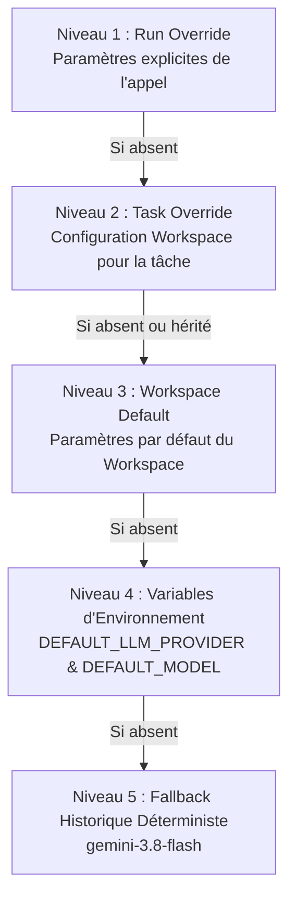

# Architecture Multi-Provider LLM & Sélection de Modèles

**Composant :** Content Operations Harness — LLM Multi-Provider Architecture  
**Version :** 1.1.0  
**Statut :** Production-Ready  
**Auteur :** Équipe DevSecOps & Architecture ContentOps  

---

## 1. Contexte & Objectifs

Initialement architecturé autour d'une intégration monolithique de Google Gemini, **ContentOps Harness** évolue vers un système multi-fournisseur unifié et extensible. Cette architecture permet :

1. L'intégration transparente du catalogue de modèles **NVIDIA** (API Catalog hébergé et conteneurs NVIDIA NIM auto-hébergés) aux côtés de **Google Gemini**.
2. La sélection et la personnalisation granulaire des modèles par l'utilisateur (au niveau du workspace, par tâche éditoriale, ou par exécution ponctuelle).
3. Le gel déterministe du contexte LLM pour chaque exécution d'agent LangGraph (**Run Freezing**).
4. La protection absolue des secrets et des réseaux internes (zéro fuite de clés API, filtrage strict SSRF).
5. La rétrocompatibilité totale avec les pipelines existants sans rupture de contrat.

---

## 2. Fournisseurs Supportés

### 2.1 Google Gemini
- **Adapter :** `GeminiProviderAdapter` (`services.orchestration.providers.gemini`)
- **SDK :** `langchain-google-genai`
- **Modèle de référence :** `gemini-3.8-flash`
- **Capacités :** `text_generation`, `structured_output`, `tool_calling`, `streaming`, `vision`
- **Configuration :** `GOOGLE_API_KEY`, `GEMINI_MODEL`, `GEMINI_ENABLED`

### 2.2 NVIDIA AI Catalog & NIM
- **Adapter :** `NVIDIAProviderAdapter` (`services.orchestration.providers.nvidia`)
- **SDK :** `langchain-nvidia-ai-endpoints` (`ChatNVIDIA`)
- **Catalogue Curé (par défaut) :**
  - `meta/llama-3.1-70b-instruct` (Recommandé pour la production et le raisonnement structuré)
  - `meta/llama-3.1-8b-instruct` (Ultra-rapide pour l'idéation et la synthèse)
  - `mistralai/mixtral-8x7b-instruct-v0.1` (Routage polyvalent)
  - `nvidia/nemotron-4-340b-instruct` (Génération longue et analyse complexe)
- **Découverte dynamique :** Requête vers le endpoint `/models` avec cache TTL (1 heure) et repli transparent sur le catalogue curé en cas d'indisponibilité réseau.

#### Distinction Hébergé vs Auto-Hébergé (NIM)
| Propriété | NVIDIA Hosted Catalog | NVIDIA Self-Hosted NIM |
| :--- | :--- | :--- |
| **Endpoint par défaut** | `https://integrate.api.nvidia.com/v1` | `http://vllm-nim.internal:8000/v1` (ex.) |
| **Authentification** | Clé API NVIDIA (`nvapi-...`) | Clé optionnelle ou token interne |
| **Gestion Réseau** | Domaine public certifié TLS | Nécessite `NVIDIA_ALLOW_LOCAL_ENDPOINTS=true` si IP privée/loopback |
| **Contrôle Données** | Cloud managé NVIDIA | Souveraineté totale sur GPU local/K8s |

---

## 3. Hiérarchie de Résolution en 5 Niveaux

Lors de l'appel d'un nœud d'agent ou d'un service, la sélection du modèle et de ses paramètres obéit à une hiérarchie stricte et prédictible, sans aucun repli silencieux :



### Règle d'Absence de Repli Silencieux (Zero Silent Fallback)
Si un provider ou un modèle spécifié au niveau 1, 2 ou 3 n'est pas configuré, désactivé, ou ne possède pas les capacités obligatoires requises par la tâche (ex: `structured_output` dans le nœud de production), le système lève immédiatement une exception typée `LLMResolutionError`.  
**Aucune bascule non sollicitée vers un autre provider n'a lieu en production**, garantissant la conformité éditoriale et la prédictibilité des coûts.

---

## 4. Gel du Contexte par Run (Run Freezing)

Dans une chaîne d'orchestration LangGraph multi-étapes, les modifications de configuration d'un workspace ne doivent pas altérer une exécution en cours.

1. **Capture initiale :** Dès le premier nœud exécuté (`research`, `insights` ou `production`), le modèle résolu est figé dans le state de l'agent :
   ```python
   resolved_context = LLMResolver.resolve_model(workspace_id, task_name="production")
   state["resolved_llm"] = resolved_context.to_dict()
   ```
2. **Réutilisation scellée :** Les nœuds aval (ex: régénération, validation QA, rewrite) réinjectent `state["resolved_llm"]` pour instancier l'exact même runtime LLM.
3. **Observabilité :** Le `ResolvedLLMContext` scellé est journalisé et attaché aux traces Langfuse (`provider_id`, `model_id`, `temperature`, `resolution_source`).

---

## 5. Sécurité, Secrets & Protection SSRF

### 5.1 Confidentialité Absolue des Clés API
- Les clés API (`NVIDIA_API_KEY`, `GOOGLE_API_KEY`) ne sont **JAMAIS** transmises au frontend ni renvoyées par les routes REST.
- Les DTO de réponse (`LLMProviderInfo`) n'exposent qu'un statut booléen : `is_configured: bool`.
- Les messages de log et les traces d'audit masquent toute présence de token secret.

### 5.2 Protection SSRF (Server-Side Request Forgery)
Pour prévenir toute exfiltration de données ou balayage d'adresses internes lors de la configuration d'un endpoint NIM personnalisé, chaque URL saisie est validée par `validate_nvidia_endpoint` :
- Protocoles autorisés : `http://` et `https://` uniquement.
- Blocage par défaut des adresses loopback (`127.0.0.1`, `localhost`), privées RFC 1918 (`10.0.0.0/8`, `172.16.0.0/12`, `192.168.0.0/16`), link-local (`169.254.169.254` AWS/GCP metadata) et non spécifiées (`0.0.0.0`).
- Pour autoriser un conteneur NIM local en environnement de développement ou cluster fermé, la variable serveur `NVIDIA_ALLOW_LOCAL_ENDPOINTS=true` doit être explicitement activée.

---

## 6. Endpoints API REST (`/v1/llm`)

| Méthode | Route | Rôles Autorisés | Description |
| :--- | :--- | :--- | :--- |
| `GET` | `/v1/llm/providers` | Tous (Viewer+) | Liste les providers déclarés et leur statut de configuration (`is_configured`). |
| `GET` | `/v1/llm/models` | Tous (Viewer+) | Liste le catalogue des modèles filtrable par `provider_id` avec paramètre `refresh`. |
| `GET` | `/v1/llm/config/{workspace_id}` | Tous (Viewer+) | Récupère la configuration LLM complète du workspace. |
| `PUT` | `/v1/llm/config/{workspace_id}` | Owner, Editor | Met à jour et persiste la configuration du workspace (avec validation SSRF). |
| `POST` | `/v1/llm/test-connection` | Owner, Editor | Déclenche un test de connectivité réel opt-in (mesure de latence en ms). |
| `POST` | `/v1/llm/validate-selection` | Tous (Viewer+) | Valide la compatibilité d'un modèle avec des capacités requises. |

---

## 7. Configuration Frontend (UI)

L'écran de paramètres (`SettingsScreen`) intègre la section dédiée **"Modèles & Providers LLM"** :
- **Cartes Fournisseurs :** Affichage de l'état de chaque provider (Gemini, NVIDIA) avec badges de configuration et bouton explicite **"Tester la connexion"**.
- **Sélecteur de Modèle par Défaut :** Liste déroulante enrichie avec recherche dynamique, étiquettes de provenance et tags de capacités (`Raisonnement`, `Outils`, `Vision`).
- **Surcharges par Tâche :** Configuration indépendante pour :
  - *Idéation & Brainstorming*
  - *Production de Contenu*
  - *Réécriture Éditée*
  - *Stratégie & Synthèse*
- **Gouvernance & RBAC :** Mode lecture seule automatique pour les utilisateurs avec rôle `Viewer` ; enregistrement protégé réservé aux `Owner` et `Editor`.

---

## 8. Procédures d'Exploitation & Rollback

### 8.1 Forçage d'Urgence vers Gemini (Kill-Switch Provider)
En cas d'incident sur l'infrastructure NVIDIA ou de rupture de quota :
1. Définir la variable d'environnement sur le serveur :
   ```bash
   DEFAULT_LLM_PROVIDER=gemini
   NVIDIA_ENABLED=false
   ```
2. Redémarrer le service d'API (`uvicorn apps.api.main:app`).
3. Tous les appels hériteront instantanément de Gemini sans interruption de service.

### 8.2 Rollback de la Base de Données
Si une annulation de migration de schéma est requise :
```bash
# Annulation de la table workspace_llm_settings
alembic downgrade -1
```
Le code applicatif bascule automatiquement et de façon transparente sur les configurations par défaut définies dans les variables d'environnement.
