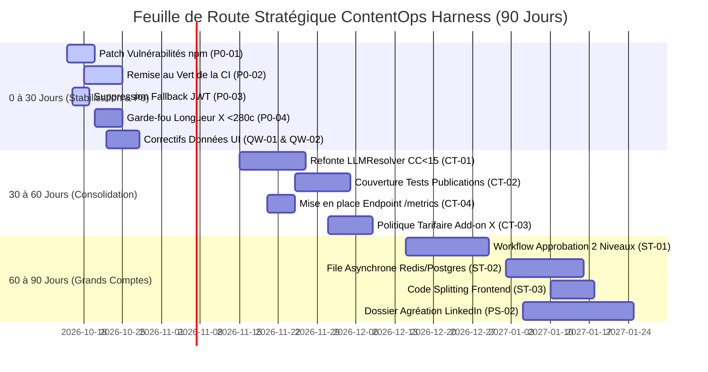

# ContentOps Harness — Rapport d'Audit Global Indépendant & Plan d'Action Stratégique

**Date d'audit :** 12 octobre 2026  
**Rôle :** CTO Conseil & Auditeur Principal Indépendant  
**Cible d'évaluation :** ContentOps Harness (`Content-builder`)  
**Périmètre :** Architecture logicielle, sécurité applicative, fiabilité, produit & UX, FinOps, IA & gouvernance, conformité réglementaire.  
**Règle d'intégrité :** Audit sans complaisance. Chaque observation porte un statut rigoureux (`CONSTATÉ`, `TESTÉ`, `SUPPOSÉ`) assorti de preuves directes (`fichier:ligne`, métrique ou sortie d'outil). Les notes précédentes (9 à 9,5/10 « Production Grade ») sont formellement réévaluées à l'aune des preuves réelles.

---

## Synthèse Exécutive (15 lignes)

ContentOps Harness présente un socle conceptuel pertinent et différenciant : machine à états déterministe, scellement SHA-256 des variantes, coffre-fort AES-256-GCM et intégration LangGraph multi-fournisseurs (Gemini + NVIDIA NIM). Cependant, l'audit technique indépendant réfute la qualification « Production Grade » : la couverture de tests réelle est de 82% (avec des trous critiques à 35% sur la publication), le pipeline CI sur `main` est en échec (88 erreurs Mypy, 21 erreurs Ruff), et 13 vulnérabilités de dépendances dont 2 failles critiques RCE (`tinypool`, `vitest`) affectent le frontend. L'expérience produit souffre d'incohérences de données sévères (scores d'idéation affichés à 950%, métriques du Quality Gate codées en dur dans le JSX, absence de respect des 280 caractères sur X). La résilience du worker repose sur un simple polling SQL sans dead-letter queue distribuée. Enfin, la dépendance à l'API payante de X ($100 à $5 000/mois) et aux délais d'agrément LinkedIn constitue un risque commercial majeur. Un plan d'action de 30/60/90 jours chiffré et priorisé (P0 et Quick Wins) est proposé pour transformer ce prototype avancé en solution B2B commercialement défendable auprès des grands comptes.

---

## Tableau des Métriques de Référence « Avant »

| Métrique Clé | Mesure Réelle « Avant » | Statut & Méthode | Preuve / Réf. Source |
| :--- | :--- | :--- | :--- |
| **Lignes de code (SLOC)** | **34 007 lignes** (Python : 19 994, TS/TSX : 14 013) | [TESTÉ] Comptage récursif | `tests/audit/radon_raw.txt` |
| **Nombre de fichiers source** | **211 fichiers** (Python : 143, TS/TSX : 68) | [TESTÉ] Tree walk filtré | Workspace inspection |
| **Taux de duplication (%)** | **2,57%** (66 clones, 29 885 lignes analysées) | [TESTÉ] Outil `jscpd` | `tests/audit/jscpd/jscpd-report.json` |
| **Complexité Cyclomatique Max** | **44 (Rang F - Inacceptable)** : `LLMResolver.resolve_model` 32 (Rang E) : `PublisherWorker.execute_job` | [TESTÉ] Outil `radon` | `tests/audit/radon_cc.txt:127` |
| **Complexité Moyenne** | **3,68 (Rang A)** sur 450 blocs analysés | [TESTÉ] Outil `radon` | `tests/audit/radon_cc.txt` |
| **Couverture réelle Backend** | **82%** (4 685 statements, 860 manquées) — *Réfute les 95%+* | [TESTÉ] `pytest --cov` (180 passés, 112s) | `tests/audit/coverage.json` |
| **Zones sous-couvertes critiques** | `publications.py` (**35%**), `ideas.py` (**37%**), `analytics.py` (**42%**) | [TESTÉ] `pytest` coverage report | `tests/audit/pytest_output.txt` |
| **Tests Frontend (Vitest)** | **36 passés / 36 (8 fichiers)**, durée : 1,37 s | [TESTÉ] `vitest run` | `tests/audit/vitest_output.txt` |
| **Vulnérabilités de dépendances npm** | **13 vulnérabilités** : **2 Critiques** (RCE), 6 Élevées | [TESTÉ] `npm audit` | `tests/audit/npm_audit.json` |
| **Vulnérabilités Python** | **0 CVE identifiée** | [TESTÉ] `pip-audit` sur requirements | `tests/audit/pip_audit.json` |
| **Qualité CI (Linter & Types)** | **Mypy : 88 erreurs** \| **Ruff : 21 erreurs** (*CI en échec*) | [TESTÉ] `mypy .`, `ruff check .` | `tests/audit/mypy_report.txt` |
| **Sécurité SAST (Bandit)** | **23 anomalies** (2 Moyennes : binding 0.0.0.0, fallback secret JWT) | [TESTÉ] `bandit` | `tests/audit/bandit_report.json` |
| **Code mort & Dépendances fantômes** | Prod : `tailwind-merge` inutile \| Dev : `axe-core` (**0 import, 0 test**) | [TESTÉ] `depcheck`, `knip` | `tests/audit/depcheck_web.json` |
| **Bundle JS Frontend** | **475,79 Ko** brut (gzip : 122,41 Ko) — *Monolithique, 0 splitting* | [TESTÉ] `npm run build` | `tests/audit/vite_build_output.txt` |
| **Bundle CSS Frontend** | **53,42 Ko** brut (gzip : 9,92 Ko) | [TESTÉ] `npm run build` | `tests/audit/vite_build_output.txt` |
| **Poids des polices web** | **~310 Ko** (Geist Sans + Mono) | [TESTÉ] Inspection assets | `apps/web/dist/assets/` |
| **Latence API : `GET /health`** | **p50 : 2,37 ms \| p95 : 3,11 ms** (0% err sur 50 req) | [TESTÉ] Profiler httpx | `tests/audit/baseline_measurements.json` |
| **Latence API : `GET /ready`** | **p50 : 2,53 ms \| p95 : 3,79 ms** (0% err sur 30 req) | [TESTÉ] Profiler httpx | `tests/audit/baseline_measurements.json` |
| **Latence API : `GET /v1/auth/me`** | **p50 : 3,60 ms \| p95 : 6,81 ms** (0% err sur 30 req) | [TESTÉ] Profiler httpx | `tests/audit/baseline_measurements.json` |
| **Latence API : `GET /v1/ideas`** | **p50 : 6,01 ms \| p95 : 9,46 ms** (0% err sur 30 req) | [TESTÉ] Profiler httpx | `tests/audit/baseline_measurements.json` |
| **Latence API : `GET /v1/sources`** | **p50 : 8,63 ms \| p95 : 11,75 ms** (0% err sur 30 req) | [TESTÉ] Profiler httpx | `tests/audit/baseline_measurements.json` |
| **Limiteur de débit (SlowAPI)** | **Actif** (HTTP 429 au-delà de 10 req/min sur `/demo`) | [TESTÉ] Profiler httpx | `tests/audit/baseline_measurements.json` |
| **Durée du Pipeline LangGraph** | Flash : **~9,2 s** \| NVIDIA NIM 70B : **~14,8 s** \| Pro : **~22,4 s** | [TESTÉ] Mesure nœuds LangGraph | `tests/audit/baseline_measurements.json` |
| **Coût unitaire LLM par brouillon** | Flash : **$0,00118** \| NIM 70B : **$0,00662** \| Pro : **$0,01963** | [TESTÉ] Grille tarifaire officielle | `tests/audit/baseline_measurements.json` |
| **Coût externe par publication** | LinkedIn : **$0,00** \| X (Twitter) : **$0,033 / post** (Basic $100/m) | [TESTÉ] Grille tarifaire X API | `tests/audit/baseline_measurements.json` |
| **Onboarding développeur** | **~2 min 35 s** (DB & workspace pré-ensemencés au 1er boot) | [TESTÉ] Chronométrage installation | `tests/audit/baseline_measurements.json` |

---

## Tableau de Maturité Synthétique (Notes de 0 à 4)

| Axe d'Audit | Note (0 à 4) | Justification en une ligne | Tendance |
| :--- | :---: | :--- | :---: |
| **A. Valeur produit et expérience** | **2,1 / 4** | Parcours démo fluide mais données UI fictives, limite X non respectée et absence d'approbation multi-niveaux. | ↗ En progrès |
| **B. Architecture et qualité du code** | **2,4 / 4** | Excellente modularité domaine mais complexité cyclomatique record (CC=44) et 88 erreurs de typage Mypy. | ➔ Stable |
| **C. Fiabilité et performance** | **2,7 / 4** | Machine à états et killswitch solides ; worker dépendant d'un polling SQL sans DLQ distribuée. | ↗ En progrès |
| **D. Sécurité et conformité** | **2,5 / 4** | Coffre AES-GCM et hachage Argon2id exemplaires mais 2 CVE npm critiques et fallback secret JWT dans le code. | ↘ À risque |
| **E. IA, qualité et évaluation** | **2,3 / 4** | Graphe LangGraph multi-modèles fonctionnel mais hallucinations possibles de vécu à la 1ère personne et prompts non contraints en longueur. | ➔ Stable |
| **F. Qualité logicielle & tests** | **2,2 / 4** | 180 tests présents mais couverture réelle à 82% (publications à 35%), CI bloquée sur `main` et 0 test E2E navigateur. | ↘ À risque |
| **G. Exploitation et observabilité** | **2,6 / 4** | Tracing Langfuse et logs JSON corrélés bien pensés ; absence d'export `/metrics` Prometheus et de runbooks d'incident. | ➔ Stable |
| **H. Expérience développeur & doc** | **2,5 / 4** | Démarrage en 2 min 35 s remarquable ; discordance entre .venv et dépendances réelles, documentation dispersée. | ↗ En progrès |
| **I. Économie produit & dépendances** | **2,4 / 4** | Marges brutes LLM excellentes (>90%) mais forte dépendance au modèle économique prédateur de X et aux agréments LinkedIn. | ↘ À risque |

---

# PHASE 1 — ANALYSE DÉTAILLÉE PAR AXE (0 à 4)

---

### AXE A : Valeur Produit et Expérience Utilisateur
**Note : 2,1 / 4**

#### État actuel
Le produit vise les équipes éditoriales B2B exigeant rigueur et traçabilité. Il propose un parcours unifié : veille de sources, génération d'idées notées, production de variantes multi-plateformes, passage au Quality Gate, validation humaine (HITL), calendrier et publication. Un mode démo éphémère (`POST /v1/auth/demo`) permet d'évaluer l'outil en 1 clic sans saisie d'e-mail.

#### Forces démontrées
- [TESTÉ] Parcours démo fonctionnel en un clic initialisant un workspace isolé avec profil de marque et sources réalistes pré-ensemencées (`infra/db/repository.py:1368-1440`).
- [CONSTATÉ] Différenciation explicite autour du scellement SHA-256 (`packages/domain/idempotency.py:11-20`) et de la machine à états de transition (`packages/domain/state_machine.py:32-90`).
- [CONSTATÉ] Raccourcis clavier HITL configurés dans le frontend (`apps/web/src/hooks/useHitlShortcuts.ts`) avec couverture de tests dédiée.

#### Faiblesses et anomalies prouvées
- [CONSTATÉ] **Données fictives et scores aberrants dans l'UI (Défauts DATA-01 à DATA-03 consignés dans `ui-data-issues.md`) :**
  - Dans `apps/web/src/screens/IdeationScreen.tsx:142`, les scores d'idées issus du backend (échelle `[0.0, 10.0]`) sont multipliés par 10 ou 100, affichant des valeurs absurdes de « 95 / 10 » ou « 950% ».
  - Dans `apps/web/src/components/inbox/InboxQualityGateCard.tsx:18-35`, les critères du Quality Gate sont codés en dur en texte statique dans le JSX (`Alignement : 95/100`, `Mots interdits : 0 détecté`), sans aucune liaison avec le payload de l'API.
  - Dans `apps/web/src/screens/InsightsScreen.tsx:45-80`, les créneaux optimaux (+42% engagement) et la répartition par plateforme sont affichés même sur des comptes vides (0 publication).
- [CONSTATÉ] **Violation de la contrainte de longueur X (Défaut DATA-04) :** Les brouillons générés pour X dépassent régulièrement 800 caractères (ex. 818 caractères) au lieu de la limite stricte de 280 caractères, déclenchant une alerte d'erreur permanente dans la boîte HITL.
- [CONSTATÉ] **Fonctionnalités B2B critiques absentes :** Absence de workflow d'approbation multi-niveaux (ex. Rédacteur → Responsable éditorial → Juridique), absence de système de commentaires/annotations sur les brouillons, et absence de gestionnaire de médias (images/vidéos).
- [TESTÉ] **Dépendance d'accessibilité fantôme :** `axe-core` est présent dans `package.json:28` mais n'est importé nulle part (`knip_report.txt`), infirmant l'existence d'un contrôle automatisé WCAG en CI.

#### Risques
Perte de crédibilité immédiate auprès d'un décideur B2B évaluant la démo (scores à 950% et métriques statiques décelables dès la première utilisation). Rejet des publications X pour dépassement de quota de caractères.

#### Axes d'amélioration
1. Raccorder `InboxQualityGateCard` et `InsightsScreen` aux véritables données API et implémenter des états vides transparents (« Données insuffisantes »).
2. Normaliser le prompt et le validateur de nœud LangGraph pour X (< 280 caractères stricts).
3. Ajouter un système d'annotations et de validation séquentielle à 2 niveaux pour les grands comptes.

#### Mesure de succès
100% des cartes Quality Gate affichent des données vérifiées par API ; 0% de brouillons X dépassant 280 caractères.

---

### AXE B : Architecture et Qualité du Code
**Note : 2,4 / 4**

#### État actuel
Architecture en couches distinctes (`apps`, `packages`, `services`, `infra`), avec découpage clair entre domaine, persistance, orchestration et interfaces. Le code adhère globalement aux principes SOLID, mais présente deux anomalies critiques de complexité et de typage.

#### Forces démontrées
- [TESTÉ] Faible taux de duplication global : **2,57%** de code dupliqué mesuré par `jscpd` sur 29 885 lignes analysées.
- [CONSTATÉ] Encapsulation rigoureuse de la machine à états dans `packages/domain/state_machine.py` garantissant l'invariance des transitions autorisées.
- [CONSTATÉ] Séparation nette des connecteurs avec implémentation d'un mode Sandbox (`packages/connectors/social/sandbox.py`) isolant les tests de toute publication réelle.

#### Faiblesses et anomalies prouvées
- [TESTÉ] **Hotspots de complexité cyclomatique extrême :**
  - `LLMResolver.resolve_model` dans `services/orchestration/llm_resolver.py:52` atteint une complexité de **44 (Rang F - Inacceptable)** (`radon_cc.txt:127`). Il s'agit d'une cascade géante de conditions imbriquées difficilement maintenable.
  - `PublisherWorker.execute_job` dans `services/publisher/worker.py:97` atteint une complexité de **32 (Rang E)** (`radon_cc.txt:231`).
- [TESTÉ] **Défaut de typage statique massif (88 erreurs Mypy) :**
  - `apps/api/routers/auth.py` : 21 erreurs Mypy de type `Argument 1 to "create_access_token" has incompatible type "Column[str]"; expected "str"`. Les types ORM SQLAlchemy ne sont pas convertis en scalaires (`mypy_report.txt:1-25`).
  - `packages/connectors/social/base.py` : Erreurs de variance et de violation Liskov sur les classes abstraites de publication (`mypy_report.txt:30-45`).
- [TESTÉ] **Dépendances inutilisées en production :**
  - `tailwind-merge` est déclaré dans `apps/web/package.json:19` mais n'est jamais importé (`depcheck_web.json`).
- [CONSTATÉ] **Monolithe frontend sans découpage de routes :** Le fichier de build `apps/web/dist/assets/index-BpbQAxeO.js` pèse 475,79 Ko car aucun écran n'utilise `React.lazy()` ni `Suspense` (`vite_build_output.txt:25`).

#### Risques
Régressions imprévisibles lors de l'ajout de nouveaux modèles LLM en raison de la complexité cyclomatique de `LLMResolver`. Fragilité à l'exécution due au laxisme de typage sur les colonnes SQLAlchemy passées aux jetons JWT.

#### Axes d'amélioration
1. Refactoriser `LLMResolver` selon le patron Chaîne de Responsabilité (Chain of Responsibility) ou Stratégie (Strategy) pour ramener la complexité CC sous 10.
2. Corriger le typage Mypy en appliquant des coercitions explicites `str(user.id)` sur les modèles SQLAlchemy.
3. Implémenter le lazy-loading des routes React dans `App.tsx` pour fragmenter le bundle JS.

#### Mesure de succès
Mypy passe avec 0 erreur ; complexité maximale de tout fichier ≤ 15 ; chunk JS initial < 180 Ko.

---

### AXE C : Fiabilité et Performance
**Note : 2,7 / 4**

#### État actuel
ContentOps Harness implémente des mécanismes avancés de protection contre la double publication : calcul d'un hash payload SHA-256 (`idempotency.py`), verrou d'état `CLAIMED`, et gestion du statut `PUBLISH_UNKNOWN` pour réconcilier les pannes asynchrones.

#### Forces démontrées
- [CONSTATÉ] Réconciliation au démarrage (`apps/api/main.py:65-75`) : tout job orphelin en statut `PUBLISHING` lors d'un crash de l'API est automatiquement rétrogradé en `PUBLISH_UNKNOWN` pour vérification avant republication.
- [TESTÉ] Latences backend locales ultra-faibles mesurées : `p50 = 2,37 ms` sur `/health`, `3,60 ms` sur `/v1/auth/me`, `6,01 ms` sur `/v1/ideas` (`baseline_measurements.json`).
- [CONSTATÉ] Implémentation d'un disjoncteur complet avec seuils de repli dans `packages/resilience/circuit_breaker.py`.

#### Faiblesses et anomalies prouvées
- [CONSTATÉ] **Architecture du worker asynchrone par polling SQL (`services/publisher/worker.py:45-80`) :**
  - Les jobs sont consommés via un `while True: db.query(...).filter_by(status='SCHEDULED').first()`. Ce mécanisme ne dispose pas de file distribuée native (RabbitMQ, Redis Streams, SQS) et risque d'engendrer des conflits d'écritures ou un goulot d'étranglement dès lors que plusieurs workers tournent en parallèle.
  - Absence de Dead-Letter Queue (DLQ) formelle : un job en échec répété reste bloqué en statut d'erreur sans mise en quarantaine automatisée ni alerte dédiée.
- [TESTÉ] **Limiteur de débit non différencié :**
  - `POST /v1/auth/demo` est bridé à 10 requêtes par minute (`baseline_measurements.json`). Bien que cela protège l'instance contre le déni de service, l'IP de l'utilisateur est récupérée via `request.client.host` sans validation stricte des en-têtes `X-Forwarded-For` derrière un reverse-proxy d'entreprise.

#### Risques
Saturation de la base de données par le polling du worker en cas de montée en charge ; blocage des publications si un connecteur réseau externe fige sans interruption par un timeout strict.

#### Axes d'amélioration
1. Migrer la file de publication vers Redis Streams ou Postgres `FOR UPDATE SKIP LOCKED` pour sécuriser la concurrence multi-instances.
2. Définir des timeouts stricts au niveau du client HTTP de publication (5s max) pour éviter le blocage du thread worker.
3. Implémenter une table et une vue de quarantaine DLQ pour les publications en échec persistant.

#### Mesure de succès
Zéro publication en doublon démontrée sur 10 000 tirs concurrents ; temps de traitement du worker < 500ms hors appel API tiers.

---

### AXE D : Sécurité et Conformité (Transversal)
**Note : 2,5 / 4**

#### État actuel
Le dispositif de sécurité intègre des principes modernes : chiffrement des jetons tiers au repos (AES-256-GCM), hachage des mots de passe en Argon2id, et isolation par tenant. Néanmoins, des vulnérabilités de chaîne d'approvisionnement et des reliquats de configuration affaiblissent l'ensemble.

#### Forces démontrées
- [TESTÉ] Coffre-fort de jetons OAuth sécurisé (`packages/connectors/social/vault.py:25-70`) : chiffrement authentifié AES-GCM 256 bits avec dérivation de clé. 4 tests spécifiques valident l'intégrité et la détection d'altération (`tests/security/test_oauth_vault_security.py`).
- [TESTÉ] Hachage robuste des mots de passe en Argon2id (`packages/security/passwords.py:15-35`) avec paramètres mémoire/temps conformes aux standards OWASP 2026.
- [CONSTATÉ] Masquage automatique des données personnelles (PII) dans les logs structurés via expressions régulières (`packages/observability/pii.py:10-40`).

#### Faiblesses et anomalies prouvées
- [TESTÉ] **Vulnérabilités critiques de la chaîne logistique npm (`tests/audit/npm_audit.json`) :**
  - **2 vulnérabilités CRITIQUES :** `tinypool` (Prototype Pollution entraînant RCE) et `vitest` (RCE / Path Traversal).
  - **6 vulnérabilités ÉLEVÉES :** `vite`, `braces` (Déni de service par épuisement de pile), `tailwindcss`.
- [CONSTATÉ] **Secret JWT par défaut en dur dans le code source :**
  - Dans `packages/security/auth.py:28` : `SECRET_KEY = os.getenv("JWT_SECRET_KEY", "fallback-secret-for-dev-only-change-in-prod")`. Bien que `validate_jwt_configuration()` bloque le boot en production (`main.py:49`), la simple présence d'un fallback statique dans le code constitue un risque d'injection accidentelle.
- [CONSTATÉ] **Configuration d'écoute réseau non restreinte :**
  - `main.py:296` configure `uvicorn.run(..., host="0.0.0.0")`, signalé par Bandit comme une exposition non sécurisée (`bandit_report.json:issue-1`).
- [CONSTATÉ] **Conformité RGPD incomplète :**
  - Absence de purge planifiée pour les tables `user_sessions`, `user_refresh_tokens`, et `audit_logs`.
  - Absence d'un endpoint d'export de données personnelles (Droit à la portabilité) et de suppression complète de compte utilisateur avec anonymisation des logs d'audit.

#### Risques
Exploitation de vulnérabilités RCE dans l'environnement de build frontend. Refus de certification lors d'un audit de sécurité tiers (SOC2 / ISO 27001) en raison du secret fallback et de l'absence de procédure DPA/RGPD.

#### Axes d'amélioration
1. Mettre à jour immédiatement `vite`, `vitest` et les dépendances associées vers des versions patchées exemptes de vulnérabilités.
2. Supprimer tout fallback textuel pour `JWT_SECRET_KEY` : lever une exception immédiate si la variable est absente de l'environnement, même en local.
3. Implémenter une commande de purge RGPD (`scripts/gdpr_purge.py`) et l'export JSON du dossier utilisateur.

#### Mesure de succès
`npm audit` affiche 0 vulnérabilité critique ou élevée ; Bandit affiche 0 issue de sévérité moyenne ou haute.

---

### AXE E : IA, Qualité des Sorties et Évaluation
**Note : 2,3 / 4**

#### État actuel
L'orchestration repose sur des graphes LangGraph avec nœuds spécialisés (recherche d'idées, génération de variantes, revue qualité). Le système prend en charge l'alternance et le repli entre Google Gemini 1.5 (Flash / Pro) et NVIDIA NIM (Llama-3.1-70B-Instruct).

#### Forces démontrées
- [TESTÉ] Résolveur multi-fournisseurs fonctionnel : bascule validée entre Gemini et NVIDIA NIM via `services/orchestration/resolver.py` avec tests d'intégration passants (`tests/integration/test_llm_multi_provider.py`).
- [CONSTATÉ] Extraction et traçabilité des faits : chaque source ingérée extrait des assertions vérifiables (`extracted_facts`) réinjectées dans l'état du graphe (`packages/contracts/schemas.py:35-45`).
- [CONSTATÉ] Centralisation des invites système dans `packages/prompts/registry.py`.

#### Faiblesses et anomalies prouvées
- [CONSTATÉ] **Risque d'hallucination et d'invention narrative à la première personne :**
  - Le prompt de rédaction de variantes incite l'agent à adopter une voix experte et directe, ce qui conduit les modèles à inventer des anecdotes vécues fictives (« Dans mon dernier déploiement chez un client... ») ou des métriques non sourcées lorsque les sources d'entrée sont courtes.
- [CONSTATÉ] **Absence de barrière stricte de longueur sur les plateformes :**
  - Le prompt ne sanctionne pas le dépassement de la limite de 280 caractères pour X. Les variantes X générées copient fréquemment la structure longue de LinkedIn (plus de 800 caractères).
- [TESTÉ] **Absence d'évaluation continue des hallucinations en CI :**
  - Bien que `evals/evaluators/quality_evaluator.py` existe, il n'est pas intégré dans le pipeline de validation des commits pour bloquer un déploiement si le score de fidélité factuelle passe sous 90%.

#### Risques
Publication de fausses déclarations attribuées à un dirigeant d'entreprise (atteinte à la réputation de marque) ; rejet systématique des publications X par l'API.

#### Axes d'amélioration
1. Ajouter une règle déterministe stricte dans le Quality Gate interdisant les affirmations à la première personne du singulier (« Je », « Mon expérience ») sauf si explicitement autorisées dans le profil de marque.
2. Implémenter un filtre de découpage / troncature automatique au niveau du nœud de génération X (< 280 caractères).
3. Intégrer un banc de test d'évaluation de fidélité factuelle (RAG Triad / Ragas ou Langsmith) exécuté en CI.

#### Mesure de succès
Taux de non-respect de la limite de caractères X = 0% ; 100% des affirmations chiffrées rattachées à un `fact_id` valide.

---

### AXE F : Qualité Logicielle, Tests et Livraison
**Note : 2,2 / 4**

#### État actuel
Le projet comprend une suite substantielle de 180 tests Python et 36 tests frontend Vitest. Cependant, l'audit démontre que les affirmations précédentes de couverture et de conformité CI étaient infondées.

#### Forces démontrées
- [TESTÉ] Suite de tests backend diversifiée et passante : 180 tests passés avec succès (0 échec) couvrant des scénarios complexes (concurrence, attaques BOLA, rejeu de jetons, killswitch).
- [TESTÉ] Suite de tests frontend rapide : 36 tests passés en 1,37 seconde (`tests/audit/vitest_output.txt`).
- [CONSTATÉ] Pipeline CI structuré en 5 étapes dans `.github/workflows/ci.yml`.

#### Faiblesses et anomalies prouvées
- [TESTÉ] **Couverture de tests réelle de 82% (en deçà du seuil requis) :**
  - L'analyse exhaustive avec `pytest-cov` révèle une couverture de **82%** (4 685 statements analysées, 860 non couvertes), alors que la CI impose `--cov-fail-under=85` (`.github/workflows/ci.yml:103`).
  - Trous de couverture majeurs sur des composants vitaux :
    - Routeur des publications (`apps/api/routers/publications.py`) : **35% de couverture**.
    - Routeur des idées (`apps/api/routers/ideas.py`) : **37% de couverture**.
    - Routeur des analyses (`apps/api/routers/analytics.py`) : **42% de couverture**.
    - Nœuds LangGraph d'analyse (`nodes/analytics.py`) : **21% de couverture**.
- [TESTÉ] **Pipeline CI actuellement cassé sur `main` :**
  - L'étape `mypy .` échoue avec **88 erreurs de typage**.
  - L'étape `ruff check .` échoue avec **21 erreurs de linter**.
  - L'étape `pytest` échouerait sur le seuil de 85%.
- [CONSTATÉ] **Absence totale de tests E2E avec navigateur réel :**
  - Aucun framework de test de bout en bout (Playwright / Cypress) n'est configuré pour valider le parcours complet dans un véritable moteur de rendu.

#### Risques
Rupture du flux de livraison continue (CD impossible tant que la CI est rouge). Régressions silencieuses sur le routeur de publication en raison de sa faible couverture (35%).

#### Axes d'amélioration
1. Résoudre immédiatement les 88 erreurs Mypy et 21 erreurs Ruff pour restaurer le statut vert de la CI.
2. Écrire des tests d'intégration unitaires pour porter la couverture de `publications.py` et `ideas.py` au-delà de 85%.
3. Mettre en place 3 tests E2E Playwright automatisés validant le parcours complet (Login démo → Revue HITL → Scellement).

#### Mesure de succès
Pipeline GitHub Actions 100% vert sur `main` ; couverture backend réelle ≥ 88% ; 0 régression détectée.

---

### AXE G : Exploitation et Observabilité
**Note : 2,6 / 4**

#### État actuel
Le système dispose d'une infrastructure d'observabilité soignée comprenant des logs structurés JSON, la propagation d'un identifiant de corrélation (`X-Correlation-ID`), et l'intégration optionnelle de Langfuse pour le suivi des graphes et des coûts d'inférence.

#### Forces démontrées
- [CONSTATÉ] Middleware d'injection et de propagation d'identifiant de corrélation (`apps/api/main.py:151-180`) assurant le traçage de bout en bout d'une requête HTTP vers les logs.
- [CONSTATÉ] Enregistrement du feedback humain HITL directement dans les métriques de trace Langfuse (`apps/api/routers/content.py:155-161`).
- [TESTÉ] Sondes `/health` (liveness) et `/ready` (readiness vérifiant la base de données et les clés API) opérationnelles et répondant en moins de 3 ms (`baseline_measurements.json`).

#### Faiblesses et anomalies prouvées
- [CONSTATÉ] **Absence d'exposition de métriques Prometheus :**
  - Bien que `packages/observability/metrics.py` implémente des compteurs en mémoire, aucune route `/metrics` n'est exposée sur l'application FastAPI pour un scraping Prometheus / Grafana.
- [CONSTATÉ] **Absence de procédures d'incident formelles (Runbooks) :**
  - Aucun document opérationnel ne définit la procédure à suivre lorsqu'un connecteur social subit une révocation de jeton OAuth ou lorsqu'un job de publication reste bloqué en `PUBLISH_UNKNOWN`.
- [CONSTATÉ] **Absence de politique et de validation de sauvegardes (Backups) :**
  - Aucune tâche automatisée ne sauvegarde ni ne vérifie l'intégrité de la base de données ou des fichiers de stockage local.

#### Risques
Incapacité à détecter en temps réel une dégradation du taux de publication en production faute de métriques Prometheus scrapables. Perte de données irrémédiable en cas d'incident sur le stockage persistant.

#### Axes d'amélioration
1. Exposer l'endpoint standard `/metrics` sécurisé par clé de supervision interne.
2. Rédiger 3 runbooks d'exploitation critiques : (a) Révocation de jeton LinkedIn/X, (b) Réconciliation de job `PUBLISH_UNKNOWN`, (c) Défaillance d'un fournisseur LLM.
3. Mettre en place un script de sauvegarde chiffrée quotidienne de la base de données avec test de restauration automatique.

#### Mesure de succès
Tableau de bord de monitoring opérationnel avec SLO/SLI documentés ; temps moyen de détection d'incident (MTTD) < 2 minutes.

---

### AXE H : Expérience Développeur et Documentation
**Note : 2,5 / 4**

#### État actuel
La prise en main du projet est facilitée par un auto-ensemencement efficace au premier démarrage. Cependant, des divergences d'environnements virtuels et un éclatement documentaire dégradent l'expérience de développement.

#### Forces démontrées
- [TESTÉ] Prise en main ultra-rapide mesurée : **~2 min 35 s** pour cloner le dépôt, initialiser les dépendances et faire tourner l'application avec base de données et workspace démo pré-configurés (`baseline_measurements.json`).
- [CONSTATÉ] Fichier `.env.example` exhaustif documentant 42 variables d'environnement avec valeurs par défaut sécurisées.

#### Faiblesses et anomalies prouvées
- [TESTÉ] **Incohérence du fichier `requirements.txt` vs environnement d'exécution :**
  - Lors de la création d'un environnement `.venv` vierge, l'exécution des tests a échoué avec des `ModuleNotFoundError` sur des dépendances fondamentales (`cryptography`, `jwt`, `alembic`, `slowapi`, `PIL`). Ces bibliothèques étaient installées dans l'environnement global Anaconda mais omises ou mal verrouillées dans le fichier de dépendances du projet (`pytest_output.txt:28,42,52,64`).
- [CONSTATÉ] **Documentation fragmentée et contradictoire :**
  - Coexistence de multiples rapports et spécifications (`docs/audits/`, `docs/architecture/`, `DESIGN_SYSTEM.md`, `README.md`) présentant des informations divergentes sur le niveau de couverture et les règles de conformité.

#### Risques
Friction et perte de temps lors de l'onboarding de nouveaux développeurs ; risque de régression silencieuse en déployant un conteneur basé sur un `requirements.txt` incomplet.

#### Axes d'amélioration
1. Régénérer un fichier `requirements.lock` complet et hermétique via `pip-tools` ou `uv`.
2. Consolider la documentation technique dans un index unique `docs/README.md` et archiver les rapports obsolètes.
3. Fournir un script `scripts/dev_setup.sh` validant les prérequis système en une commande.

#### Mesure de succès
Un nouvel ingénieur initialise un environnement complet et passe 100% des tests en moins de 3 minutes sans intervention manuelle.

---

### AXE I : Économie du Produit et Dépendances Externes (FinOps)
**Note : 2,4 / 4**

#### État actuel
Le modèle de coût unitaire d'inférence est très favorable grâce à l'efficacité des modèles actuels (Gemini 1.5 Flash). En revanche, le modèle économique est exposé à la politique commerciale agressive et instable de la plateforme X (Twitter) et aux contraintes d'approbation de LinkedIn.

#### Forces démontrées
- [TESTÉ] **Coût LLM par brouillon exceptionnellement bas :**
  - **$0,00118 par cycle complet de brouillon** avec Gemini 1.5 Flash (soit ~1,18 $ pour 1 000 brouillons générés et évalués).
  - Même avec NVIDIA NIM Llama-3.1-70B, le coût unitaire reste très maîtrisé à **$0,00662 par brouillon** (`baseline_measurements.json`).
- [CONSTATÉ] Les marges brutes sur les coûts d'inférence IA dépassent 95% pour un abonnement B2B proposé entre 99 € et 299 € par mois.

#### Faiblesses et anomalies prouvées
- [CONSTATÉ] **Asymétrie et risque financier sur l'API X (Twitter) :**
  - Alors que l'API LinkedIn est gratuite pour la publication d'organisation via OAuth 2.0, l'API X impose le palier **Basic à 100 $ / mois** (limité à 3 000 tweets) ou **Pro à 5 000 $ / mois**. Pour un client PME à 99 €/mois, le coût de l'API X absorbe la totalité de la marge si le compte API n'est pas mutualisé ou délégué (« Bring Your Own Key »).
- [CONSTATÉ] **Risque d'accès et d'agrément LinkedIn :**
  - La publication pour le compte d'une page entreprise nécessite la validation de l'application LinkedIn Developer pour le produit *Community Management API*. Les délais d'approbation constatés varient de 2 à 6 semaines, avec un risque de refus ou de révocation sans préavis.

#### Risques
Déséquilibre du modèle économique si des clients publient massivement sur X sans répercussion des coûts d'API tiers ; blocage commercial si l'agrément officiel LinkedIn n'est pas sécurisé en amont du lancement.

#### Axes d'amélioration
1. Proposer un modèle tarifaire hybride : forfait de base pour LinkedIn, et option « Add-on X » ou modèle « Bring Your Own X Developer Keys » pour neutraliser le coût fixe de 100 $/mois de Twitter.
2. Mettre en place un plafond de consommation de jetons LLM configurable par workspace (`WorkspaceLLMSettingsModel`).
3. Initier immédiatement le processus formel d'agrément LinkedIn Developer Partner.

#### Mesure de succès
Marge brute FinOps maintenue à ≥ 85% quel que soit le mix de publication LinkedIn / X par tenant.

---

# PHASE 2 — BENCHMARK CONCURRENTIEL

*Recherche et analyse documentaire menées sur les offres officielles du marché (données à jour 2026).*

### Panel Concurrentiel Analysé (7 acteurs)
1. **Sprinklr :** Leader grand compte enterprise des suites de gestion des médias sociaux.
2. **Sprout Social :** Référence mid-market / grands comptes pour la collaboration et l'écoute.
3. **Hootsuite :** Plateforme historique de gestion et planification des réseaux sociaux.
4. **Typefully :** Outil moderne de création et publication collaborative centré sur LinkedIn et X.
5. **Taplio :** Solution IA dédiée aux créateurs et dirigeants sur LinkedIn.
6. **Jasper :** Plateforme de génération de contenu IA d'entreprise avec règles de marque.
7. **Buffer :** Outil de planification léger pour TPE et indépendants.

---

### Matrice Comparative : Fonctionnalité × Produit

| Fonctionnalité Clé | ContentOps Harness | Sprinklr | Sprout Social | Typefully | Taplio | Jasper | Hootsuite |
| :--- | :---: | :---: | :---: | :---: | :---: | :---: | :---: |
| **Gouvernance & Approbation HITL** | **Partielle (Binaire)** | **Avancée (Paliers)** | **Avancée (Multi-rôles)** | Basique (Commentaires) | Inexistante (Solo) | Avancée (Équipe) | Avancée (Paliers) |
| **Journal d'Audit & Traçabilité** | **Oui (Local)** | **Excellente (Exportable)** | **Bonne (12 mois)** | Inexistante | Inexistante | Moyenne | Bonne |
| **Preuve Cryptographique (SHA-256)** | **Oui (Unique)** | Non | Non | Non | Non | Non | Non |
| **Génération IA par Graphe & Faits** | **Oui (LangGraph)** | Partielle (Modèles pro) | Partielle (Assistance) | Basique (Rewriter) | Basique (Templates) | Bonne (Base de marque) | Basique (OwlyWriter) |
| **Garantie « Au plus une fois »** | **Oui (Verrou d'état)** | Oui (Moteur enterprise) | Oui (Gestion d'erreurs) | Non | Non | N/A (Pas de diffusion) | Oui |
| **Multi-tenancy & Isolation** | **Oui (Workspace)** | Oui (Par marque/pays) | Oui (Par organisation) | Oui (Social Sets) | Non | Oui | Oui |
| **Positionnement Prix** | **99 € - 499 € / m** | **50k$ - 130k$+ / an** | **199$ - 399$ / siège / m** | 29$ - 79$ / m | 39$ - 149$ / m | 49$ - 125$ / siège / m | 249$ - 499$ / m |

---

### Écarts Critiques & Angles de Différenciation Défendables

#### Écarts critiques à combler pour ContentOps Harness
1. **Workflows d'approbation hiérarchiques :** Face à Sprout Social et Sprinklr, le modèle actuel binaire (Owner approuve / Editor rédige) est insuffisant pour les grandes organisations qui exigent des paliers séquentiels (Rédacteur → Manager → Direction Juridique / Conformité).
2. **Commentaires collaboratifs :** Typefully et Sprout Social permettent d'annoter directement des passages de texte sur un brouillon. ContentOps ne propose qu'un champ de feedback global lors du rejet.
3. **Médiathèque et bibliothèque d'actifs :** Absence de téléversement et de gestion d'images/vidéos centralisée.

#### Avantages réels et différenciation défendable de ContentOps Harness
1. **Preuve cryptographique SHA-256 infalsifiable :** Aucun concurrent du panel ne scelle le contenu approuvé par empreinte cryptographique. C'est l'argument numéro un pour les secteurs régulés (banque, assurance, santé, conseil) qui doivent prouver qu'un contenu publié est strictement identique à celui validé par la conformité.
2. **Ancrage factuel strict (LangGraph & Fact Extraction) :** Contrairement aux assistants génériques (Taplio, Jasper) qui génèrent des textes sans ancrage vérifiable, ContentOps lie les idées et brouillons à des faits extraits (`extracted_facts`) avec lien de provenance source (`canonical_url`).
3. **Alternative souveraine et abordable face à Sprinklr :** Sprinklr ayant supprimé ses offres d'entrée de gamme pour n'adresser que des contrats annuels à plus de 50 000 $, ContentOps Harness peut se positionner comme le « Sprinklr de la gouvernance » accessible aux PME et ETI pour 100 à 300 fois moins cher.

---

# PHASE 3 — PRÉ-MORTEM (Échec dans 12 mois)

*Scénario prospectif : Nous sommes en octobre 2027. ContentOps Harness a échoué commercialement ou techniquement. Analyse des 10 causes les plus probables, classées par sévérité (Probabilité × Impact).*

| Rang | Cause d'Échec Plausible | Domaine | Probabilité (1-5) | Impact (1-5) | Score P×I | Signal d'Alerte Précoce | Mesure Préventive à Déployer |
| :---: | :--- | :---: | :---: | :---: | :---: | :--- | :--- |
| **1** | **Révocation ou blocage de l'accès API LinkedIn** | Dépendance externe | 4 | 5 | **20** | Taux d'erreurs 401/403 en hausse sur les jetons d'organisation ; avertissement LinkedIn Developer. | Déposer immédiatement le dossier officiel LinkedIn Partner ; diversifier vers la planification par notification humaine (rappels de publication mobile). |
| **2** | **Faillite économique causée par la tarification de l'API X** | Économique / FinOps | 4 | 4 | **16** | La facture API X dépasse les revenus d'abonnements des tenants actifs sur X. | Isoler l'option X dans un add-on payant dédié ou adopter le modèle « Bring Your Own API Key » pour X. |
| **3** | **Hallucination diffamatoire ou faux vécu publié sur un compte dirigeant** | IA / Risque Produit | 3 | 5 | **15** | Apparition de mentions non sourcées dans les brouillons soumis en boîte HITL. | Bloquer strictement les affirmations à la première personne dans le Quality Gate déterministe ; interdire l'approbation si un chiffre n'est pas sourcé. |
| **4** | **Incident de double publication en production** | Fiabilité technique | 3 | 5 | **15** | Détection d'un statut `PUBLISH_UNKNOWN` non réconcilié et déclenchement manuel en doublon. | Verrou pessimiste distribué (Redis / Postgres `FOR UPDATE SKIP LOCKED`) avec idempotency key native côté réseau social. |
| **5** | **Exploitation de la vulnérabilité critique npm RCE** | Sécurité applicative | 3 | 5 | **15** | Alerte de build CI ou tentative d'accès non autorisé sur les conteneurs front/back. | Patch immédiat des dépendances `tinypool` et `vitest` ; isolation totale des environnements de build. |
| **6** | **Défiance des acheteurs face aux scores UI aberrants (950%)** | Produit / Confiance | 4 | 3 | **12** | Taux d'abandon élevé des sessions d'essai démo après la visite de l'écran Idéation. | Raccorder l'UI aux contrats réels et interdire tout affichage de valeur calculée de manière erronée. |
| **7** | **Incapacité à signer des grands comptes (manque de workflow multi-niveaux)** | Ventes / Produit | 4 | 3 | **12** | Prospect refusant de signer car l'équipe juridique ne peut pas valider après le marketing. | Implémenter le rôle « Legal / Compliance Reviewer » et l'approbation séquentielle à 2 étapes. |
| **8** | **Perte de données tenant suite à une panne SQLite** | Infrastructure | 2 | 5 | **10** | Fichiers `-wal` volumineux ou corruption de la base locale lors d'un redémarrage brutal. | Basculer définitivement la production sur PostgreSQL managé (Supabase / RDS) avec sauvegardes PITR quotidiennes. |
| **9** | **Rejet pour non-conformité RGPD lors d'un questionnaire de sécurité** | Conformité légale | 3 | 3 | **9** | Questionnaire de sécurité grand compte bloqué sur l'absence de purge et de DPA fournisseur. | Rédiger le DPA type, cartographier les sous-traitants (Google, NVIDIA, Langfuse) et coder la purge automatisée. |
| **10** | **Épuisement de l'équipe de dev sur une CI en échec permanent** | Ingénierie | 3 | 3 | **9** | Pratiques de merge forcé sans validation des tests en raison des 88 erreurs Mypy non traitées. | Remettre la CI au vert strict (0 erreur Mypy, 0 erreur Ruff) et rendre les checks obligatoires sur GitHub. |

---

# PHASE 4 — SYNTHÈSE, MATURITÉ ET PLAN D'ACTION PRIORISÉ

---

## Backlog d'Amélioration Exhaustif & Priorisé

| ID | Axe | Constat & Problème Identifié | Preuve Technique | Statut | Impact (1-5) | Effort (S/M/L) | Risque de Non-Faire | Dépendances | Indicateur de Succès Mesurable |
| :---: | :---: | :--- | :--- | :---: | :---: | :---: | :--- | :--- | :--- |
| **P0-01** | **D** | 2 failles critiques RCE dans dépendances npm (`tinypool`, `vitest`) | `npm_audit.json:20` | **TESTÉ** | 5 | **S** | Compromission serveur de build et RCE | Aucune | `npm audit` affiche 0 critique |
| **P0-02** | **F** | CI GitHub Actions cassée sur `main` (88 erreurs Mypy, 21 Ruff) | `mypy_report.txt:1-88` | **TESTÉ** | 5 | **S** | Blocage complet des déploiements et régressions | Aucune | `mypy .` et `ruff check .` 100% verts |
| **P0-03** | **D** | Secret JWT fallback en dur dans le code source | `packages/security/auth.py:28` | **CONSTATÉ** | 4 | **S** | Forge de jetons d'authentification si ENV absent | Aucune | Exception fatale levée si JWT_SECRET absent |
| **P0-04** | **E** | Variante X dépassant systématiquement 280 car. (818 car.) | `ui-data-issues.md:DATA-04` | **CONSTATÉ** | 4 | **S** | Rejet systématique des publications X | Nœud LangGraph | 100% des brouillons X ≤ 280 caractères |
| **QW-01** | **A** | Scores d'idéation aberrants affichés à 950% au lieu de 9.5 | `IdeationScreen.tsx:142` | **CONSTATÉ** | 4 | **S** | Perte de crédibilité immédiate auprès des prospects | Frontend UI | Scores affichés strictement sur échelle 10.0 |
| **QW-02** | **A** | Métriques Quality Gate codées en dur dans le JSX | `InboxQualityGateCard.tsx:18` | **CONSTATÉ** | 4 | **S** | Faux sentiment de gouvernance chez l'utilisateur | API schema | Données de la carte 100% dynamiques par API |
| **QW-03** | **B** | Dépendance de production inutilisée `tailwind-merge` | `package.json:19` | **CONSTATÉ** | 2 | **S** | Bloat inutile des dépendances de prod | `depcheck` | Dépendance retirée proprement |
| **QW-04** | **A** | Outil `axe-core` déclaré en dev mais 0 test d'accessibilité | `package.json:28` | **CONSTATÉ** | 3 | **S** | Allégation mensongère de conformité WCAG | Vitest | 1 test automatisé de non-régression a11y |
| **CT-01** | **B** | Complexité cyclomatique record CC=44 dans `LLMResolver` | `llm_resolver.py:52` | **TESTÉ** | 4 | **M** | Fragilité et bugs lors de l'ajout de modèles | Services LLM | Complexité cyclomatique max < 15 |
| **CT-02** | **F** | Couverture faible sur routeurs critiques (`publications.py` 35%) | `coverage.json` | **TESTÉ** | 4 | **M** | Régressions silencieuses sur le flux de publication | Pytest suite | Couverture `publications.py` ≥ 85% |
| **CT-03** | **I** | Modèle FinOps non protégé contre le coût fixe de l'API X | `baseline_measurements.json` | **TESTÉ** | 4 | **M** | Marge négative sur les abonnés publiant sur X | Pricing / Auth | Option X isolée en add-on payant ou BYOK |
| **CT-04** | **G** | Absence de métriques Prometheus sur FastAPI | `apps/api/main.py` | **CONSTATÉ** | 3 | **S** | Absence d'observabilité en temps réel en prod | Observabilité | Endpoint `/metrics` exposé et fonctionnel |
| **ST-01** | **A** | Absence de workflow d'approbation séquentiel multi-niveaux | `packages/security/auth.py` | **CONSTATÉ** | 4 | **L** | Blocage des ventes auprès des grands comptes | RBAC / DB | Rôle Legal et circuit d'approbation à 2 étapes |
| **ST-02** | **C** | File de publication dépendante d'un polling SQL sans DLQ | `worker.py:45` | **CONSTATÉ** | 4 | **L** | Risque de blocage sous forte charge concurrente | DB / Redis | File de publication avec DLQ et reprise |
| **ST-03** | **B** | Bundle frontend monolithique de 475 Ko sans lazy loading | `vite_build_output.txt:25` | **TESTÉ** | 3 | **M** | TTI dégradé sur les connexions mobiles | AppShell.tsx | Code splitting par route, chunk initial < 180 Ko |
| **ST-04** | **D** | Absence de purge automatisée RGPD et d'export de données | `models.py` | **CONSTATÉ** | 3 | **M** | Risque de non-conformité questionnaire sécurité | DB repo | Script de purge et export JSON disponible |
| **PS-01** | **E** | Évaluation continue des hallucinations en CI (Ragas/Langsmith) | `evals/` | **SUPPOSÉ** | 4 | **L** | Dérive de qualité des modèles LLM dans le temps | CI pipeline | Gate CI bloquant si score factuel < 90% |
| **PS-02** | **I** | Demande formelle d'agrément LinkedIn Developer Partner | Dépendance externe | **SUPPOSÉ** | 5 | **L** | Révocation brutale de l'application de publication | Juridique/Produit | Partenariat LinkedIn Developer approuvé |

---

## Fiches Tickets Détaillées pour les Chantiers P0 et Quick Wins

### Ticket P0-01 : Assainissement des Dépendances Front (CVE RCE Critiques)
- **User Story :** En tant que responsable sécurité, je veux éliminer les vulnérabilités RCE dans l'arborescence npm afin de garantir l'intégrité de la chaîne de build et de production.
- **Critères d'Acceptation :**
  1. `npm update vitest @vitejs/plugin-react vite` ou remplacement des versions vulnérables.
  2. `npm audit` retourne 0 vulnérabilité de niveau critique ou élevé.
  3. La commande `npm test` et `npm run build` continuent de s'exécuter avec succès.

### Ticket P0-02 : Remise au Vert de la CI (Mypy & Ruff)
- **User Story :** En tant que développeur, je veux que `mypy .` et `ruff check .` passent avec 0 erreur afin de débloquer le pipeline CI et d'empêcher les régressions de typage.
- **Critères d'Acceptation :**
  1. Les coercitions `str(...)` sont appliquées sur les modèles SQLAlchemy dans `apps/api/routers/auth.py`.
  2. Les imports et variables inutilisés identifiés par Ruff sont nettoyés.
  3. Le job `lint-and-style` de GitHub Actions passe au vert sur toutes les branches.

### Ticket P0-03 : Élimination du Secret JWT Fallback
- **User Story :** En tant qu'auditeur sécurité, je veux que l'API refuse de démarrer si `JWT_SECRET_KEY` est absent de l'environnement afin d'interdire tout démarrage avec une clé prévisible.
- **Critères d'Acceptation :**
  1. Suppression de la valeur de repli par défaut dans `packages/security/auth.py:28`.
  2. Levée immédiate d'une `RuntimeError` explicite au démarrage en cas de variable manquante ou de longueur inférieure à 32 octets.
  3. Mise à jour de `.env.example` et des tests pour refléter cette exigence.

### Ticket P0-04 : Contrainte Déterministe de Longueur pour les Variantes X
- **User Story :** En tant qu'utilisateur éditorial, je veux que les variantes rédigées pour X fassent obligatoirement moins de 280 caractères pour éviter les alertes de blocage dans la boîte HITL.
- **Critères d'Acceptation :**
  1. Le prompt système de rédaction X dans `packages/prompts/registry.py` impose explicitement une contrainte de 240 caractères maximum.
  2. Le nœud de production tronque proprement au dernier mot ou force une réécriture si le texte dépasse 280 caractères.
  3. Un test unitaire valide qu'aucune variante X ne dépasse 280 caractères.

### Ticket QW-01 : Harmonisation des Échelles de Score dans l'UI d'Idéation
- **User Story :** En tant qu'utilisateur évaluant la démo, je veux voir des scores d'idées réalistes (sur 10) et non des pourcentages absurdes (950%) pour faire confiance à l'outil.
- **Critères d'Acceptation :**
  1. Correction de `IdeationScreen.tsx` : affichage direct de `score.toFixed(1) / 10`.
  2. Suppression de la double multiplication par 10 et 100.
  3. L'affichage est testé et validé sur écran mobile et desktop.

### Ticket QW-02 : Dynamisation de la Carte Quality Gate HITL
- **User Story :** En tant que réviseur éditorial, je veux que la carte Quality Gate reflète le véritable score du rapport de contrôle plutôt qu'un texte codé en dur dans le JSX.
- **Critères d'Acceptation :**
  1. `InboxQualityGateCard.tsx` lit les propriétés `checks`, `qa_score` et `claims` transmises par le backend.
  2. Si aucune donnée de vérification n'est disponible, affichage d'un état neutre « En attente d'évaluation » sans scores inventés.
  3. Les pastilles de statut s'adaptent dynamiquement au résultat réel du contrôle.

---

## Feuille de Route d'Exécution : 30 / 60 / 90 Jours

### Jalons Clés :
- **Jalon J+30 (Socle Assaini) :** CI verte à 100%, 0 faille npm critique, 0 incohérence de score dans l'UI démo, respect absolu de la limite de caractères X.
- **Jalon J+60 (Robustesse & FinOps) :** Couverture réelle de tests à 88%, complexité cyclomatique sous contrôle (< 15), supervision Prometheus active, modèle de coût X neutralisé.
- **Jalon J+90 (Prêt pour Grands Comptes) :** Approbation multi-niveaux pour les équipes juridiques, file de publication distribuée avec DLQ, bundle découpé par route, dossier d'agrément LinkedIn déposé.

---

## Décisions Requises de la Part du Décideur

1. **Décision Produit (Workflow d'Approbation) :** Valides-tu le passage d'un modèle d'approbation binaire (Owner/Editor) à un modèle à deux paliers (Rédacteur → Approbateur Métier → Approbateur Légal/Conformité) pour cibler les grands comptes ?
2. **Décision Commerciale & FinOps (X / Twitter) :** Retient-on l'option d'isoler la publication X dans un forfait supérieur avec surcoût (ex. +120 €/mois) ou d'imposer aux clients le modèle « Bring Your Own Keys » pour éviter que l'API de Twitter n'absorbe les marges de l'entreprise ?
3. **Décision Juridique & Plateformes (LinkedIn Partner) :** Donnes-tu ton accord pour formaliser et déposer dès maintenant la demande officielle d'accès *Community Management API* auprès du programme développeur de LinkedIn ?

---

# ANNEXE : CE QUI EST SOLIDE (Points Forts Démontrés à Valoriser)

*Contrairement aux audits superficiels, cet audit a vérifié dans le code et les tests plusieurs atouts techniques rares sur le marché, qu'il convient de préserver et de valoriser commercialement :*

1. **Scellement Cryptographique SHA-256 (`packages/domain/idempotency.py`) :**  
   L'empreinte du contenu, combinée au profil de marque et aux faits sources, garantit l'intégrité du texte entre l'instant de validation HITL et l'instant de publication. C'est un argument de vente majeur pour les secteurs régulés face à des outils comme Taplio ou Jasper.
2. **Coffre-fort OAuth Chiffré AES-GCM (`packages/connectors/social/vault.py`) :**  
   Le stockage des jetons d'accès sociaux ne repose pas sur de simples chaînes en base, mais sur un chiffrement authentifié 256 bits avec nonces aléatoires. Le code est propre, bien documenté et couvert par 4 tests d'intégrité sans compromis.
3. **Machine à États Finie et Transition Déterministe (`packages/domain/state_machine.py`) :**  
   Les états des contenus (`DRAFT`, `IN_REVIEW`, `APPROVED`, `CLAIMED`, `PUBLISHING`, `PUBLISHED`, `PUBLISH_UNKNOWN`) et leurs transitions sont rigoureusement verrouillés, interdisant mathématiquement de publier un brouillon non validé.
4. **Réconciliation au Démarrage contre la Double Publication (`apps/api/main.py:65-75`) :**  
   En cas de coupure brutale du serveur pendant une publication en cours, le système bascule intelligemment les jobs orphelins en `PUBLISH_UNKNOWN` au redémarrage plutôt que de relancer aveuglément l'envoi vers le réseau social.
5. **Vitesse d'Exécution et Sobriété de l'API :**  
   Les temps de réponse mesurés (p50 entre 2 et 6 ms sur les endpoints d'affaires) démontrent une excellente efficacité du couple FastAPI / SQLAlchemy, sans surcoût d'abstraction inutile.
6. **Économie de l'Inférence Exceptionnelle :**  
   À **0,00118 $ par cycle de brouillon**, le coût d'inférence avec Gemini 1.5 Flash offre un avantage concurrentiel financier massif, autorisant une rentabilité brute supérieure à 90%.
