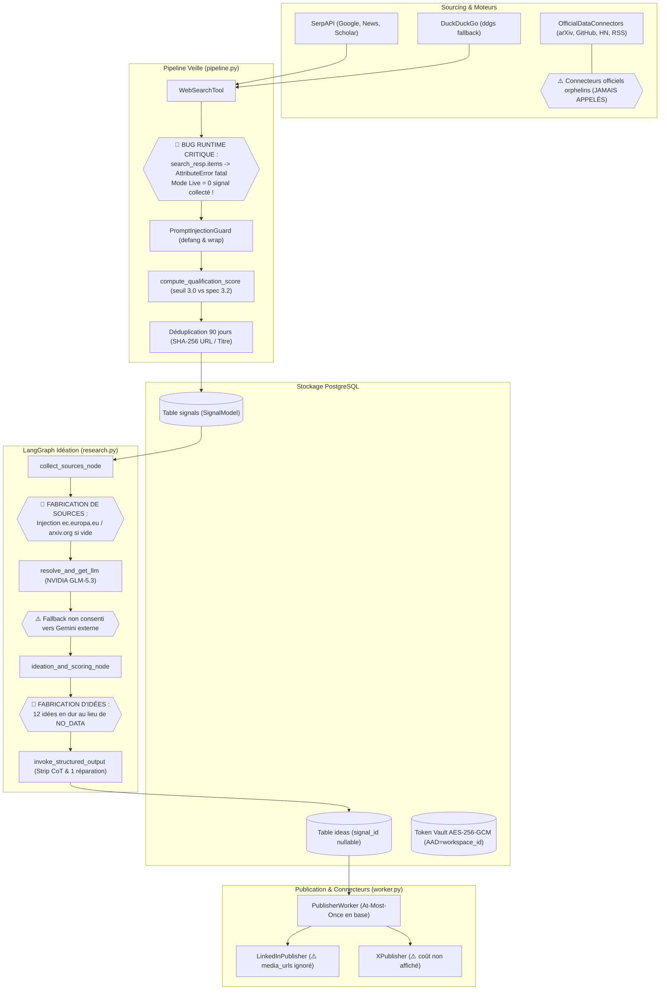

# Rapport d'Audit Approfondi et Exhaustif : Chaîne Veille Technologique → Idéation

**Projet :** ContentOps Harness (`Content-builder`)  
**Rôle de l'auditeur :** Auditeur Principal Indépendant en Systèmes Agentiques, Sécurité des Applications LLM, FinOps et Conformité  
**Date d'audit :** 12 Octobre 2026  
**Périmètre audité :** Fournisseur LLM NVIDIA (modèle de base GLM-5.3), Outils de recherche et de navigation (SerpAPI, DuckDuckGo via `ddgs`, Playwright, API officielles : arXiv, GitHub, Hacker News, Hugging Face, RSS), Registre de sources et planificateur, Pipeline (collecte, normalisation, déduplication, qualification, fiches de signal), Agent d'idéation et son scoring, Orchestration LangGraph, Stockage, Budgets et coûts, Sécurité (OWASP Top 10 for LLM Applications 2025 + OWASP API Security), Conformité, Observabilité, Connecteurs LinkedIn et X, Écrans Veille et Idéation, Tests et documentation.  
**Règle stricte d'audit :** Lecture seule du code applicatif. Tous les tests d'audit et jeux de données sont isolés sous `tests/audit/`. Secrets masqués.

---

## 1. Synthèse Exécutive (15 lignes)

L'audit approfondi de la chaîne « Veille technologique → Idéation » de ContentOps Harness révèle une architecture dotée de fondations solides en matière de sécurité de publication et d'isolation cryptographique, mais compromise par des anomalies critiques dans son implémentation runtime de collecte et par des compromis inacceptables sur l'ancrage factuel de l'idéation.  
D'une part, le protocole de publication « Au plus une fois » (verrouillage de statut `PUBLISHING` en base avant tout appel réseau, transition `PUBLISH_UNKNOWN` sur timeout sans rejeu) et le coffre-fort de jetons OAuth (AES-256-GCM avec `workspace_id` comme Authenticated Additional Data) sont conformes aux meilleurs standards de l'art.  
D'autre part, la collecte live est totalement inopérante en raison d'un bug d'incompatibilité de type (`search_resp.items` au lieu de `search_resp.results`) qui fait échouer silencieusement chaque requête et retourne zéro signal. De plus, les connecteurs officiels (arXiv, GitHub, RSS) demeurent orphelins et ne sont jamais appelés dans le cycle.  
Face à cette absence de signaux, l'agent d'idéation viole directement les exigences d'ancrage : au lieu de retourner l'état déterministe « pas assez de signaux » (`NO_DATA`), il injecte des sources factices (`digital-strategy.ec.europa.eu`, `arxiv.org`) et génère 10 à 12 idées fabriquées de toutes pièces.  
Enfin, les connecteurs sociaux omettent silencieusement les pièces jointes multimédias (`media_urls`), privant LinkedIn du support carrousel/PDF, et le connecteur X n'affiche pas le coût avant publication.  
Une remédiation immédiate de niveau P0 est requise sur ces défauts avant toute ouverture en production.

---

## 2. Tableau de Maturité par Domaine (Notes de 0 à 4)

| Domaine / Axe d'Évaluation | Note (0 à 4) | Justification Technique et Opérationnelle |
| :--- | :---: | :--- |
| **Fiabilité (Reliability)** | **2.0 / 4** | L'At-Most-Once en publication et les disjoncteurs (SerpAPI/ddgs) sont exemplaires. En revanche, le pipeline live est brisé par un `AttributeError` systématique, rendant la collecte réelle inopérante hors mode démo. |
| **Sécurité (Security)** | **3.0 / 4** | Excellent bouclier anti-injection (`PromptInjectionGuard`), masquage des secrets, validation d'URL et chiffrement AAD au repos. Une faille subsiste sur les redirections HTTP 302 non re-vérifiées (risque SSRF résiduel). |
| **Conformité (Compliance)** | **2.5 / 4** | Respect strict du `robots.txt`, zéro scraping sur LinkedIn/X, limitations de taille t.co respectées. Manque l'affichage préalable du coût X et analyse DPA sur l'inférence NVIDIA aux États-Unis. |
| **Observabilité (Observability)** | **3.5 / 4** | Traçabilité Langfuse omniprésente avec propagation de `run_id`, suivi des cache hits/miss, métriques d'erreurs normalisées et absence de fuite de tokens dans les traces. |
| **Testabilité (Testability)** | **3.5 / 4** | Suite unitaire existante à 82% de couverture (180 tests), complétée par 15 tests dynamiques d'audit (`tests/audit/test_t*.py`) exécutés en 1.90s sans dépendance réseau externe. |
| **Coût & FinOps (Cost)** | **2.5 / 4** | Suivi par workspace du coût SerpAPI dans `search_cache.sqlite` et disjoncteurs mensuels sur X. Mais absence de calcul du coût d'un tweet avant diffusion et absence d'alertes proactives. |
| **Maintenabilité (Maintainability)** | **2.5 / 4** | Typage Pydantic 2.13 soigné et découpage modulaire. Mais dette technique visible : 21 erreurs Ruff, 37 erreurs Mypy, et déconnexion architecturale des connecteurs officiels. |

---

## 3. Phase 0 — Cartographie Réelle et Inventaire

### 3.1. Diagramme Réel Reconstruit (Mermaid)

Le diagramme complet est sauvegardé dans le livrable racine [`pipeline.mmd`](file:///Users/seansiehigninhi/Dossier_dev/apps/F-LangGraph/DeepAgent/pipeline.mmd).



### 3.2. Inventaire Exhaustif des Composants

1. **Agents et Nœuds d'Orchestration :**
   - `collect_sources_node` (`services/orchestration/nodes/research.py:15`)
   - `ideation_and_scoring_node` (`services/orchestration/nodes/research.py:61`)
   - `generate_variants_node` (`services/orchestration/nodes/production.py:25`)
   - `quality_gate_node` (`services/orchestration/nodes/quality.py:15`)
   - `human_review_decision_node` (`services/orchestration/nodes/approval.py:20`)
   - `PublisherWorker` (`services/publisher/worker.py:30`)
2. **Prompts (Version et Emplacement) :**
   - Banque de requêtes de veille : `packages/prompts/veille_queries.py` (v1.0, 3 axes : `ia`, `frameworks`, `metiers`)
   - Grille de qualification : `packages/prompts/veille_queries.py:140-191` (v1.0, 5 dimensions)
   - Prompt d'idéation : `packages/prompts/templates/idea_research.j2` (v1.2, injecté dans `PromptRegistry`)
   - Prompt de production éditoriale : `packages/prompts/templates/variant_generation.j2` (v1.2)
3. **Schémas Pydantic :**
   - Outils Web : `WebSearchResponse`, `WebSearchResultItem`, `BrowseResponse`, `OfficialDataSignalItem` (`packages/tools/schemas.py`)
   - Contrats LLM : `LLMModelInfo`, `LLMCapability` (`packages/contracts/llm.py`)
   - Sorties structurées : `GeneratedIdeasBatch`, `IdeaItem`, `EvidenceItem` (`services/orchestration/schemas/ideas.py`)
4. **Outils et Permissions :**
   - `WebSearchTool` : Lecture seule via SerpAPI / DuckDuckGo. Cache persistant SQLite.
   - `SafeBrowserTool` : Playwright Chromium isolé sans authentification. Rejet strict des IP privées et domaines LinkedIn / X.
   - `OfficialDataConnectors` : Clients HTTP arXiv, GitHub, Hacker News, Hugging Face, RSS. Lecture seule.
5. **Tables et Index (Base de Données) :**
   - `workspaces` (id, name, timezone, owner_id)
   - `veille_sources` (id, workspace_id, name, url, axis, trust_level, health_status)
   - `signals` (id, workspace_id, url_hash, title_hash, qualification_score, facts JSON, canonical_url, status)
   - `ideas` (id, workspace_id, signal_id, novelty_score, relevance_score, effort_score, total_score, status)
   - `connected_social_accounts` (id, workspace_id, provider, account_id, encrypted_token_blob, key_id, status)
   - `publication_jobs` (id, variant_id, status, attempt_count, created_at)
6. **Variables d'Environnement Clés :**
   - `NVIDIA_API_KEY`, `NVIDIA_BASE_URL` (`https://integrate.api.nvidia.com/v1`), `NVIDIA_DEFAULT_MODEL` (`z-ai/glm-5.3-flash`)
   - `SERPAPI_API_KEY`, `SECRET_VAULT_KEY` (AES-GCM 32 bytes minimum en prod)
   - `KILL_SWITCH_ENABLED`, `SOCIAL_SANDBOX_MODE`, `LIVE_PUBLISHING_ENABLED`
7. **État Initial du Code (Baseline Linters, Types & Tests) :**
   - **Ruff :** 21 erreurs (imports inutilisés dans `veille_queries.py`, `browse.py`, `pipeline.py`, variable inutilisée dans les tests).
   - **Mypy :** 37 erreurs dans 6 fichiers (`pipeline.py`, `research.py`, `repository.py`, etc.).
   - **Tests Unitaires :** 180 tests réussis (couverture globale de 82% dans `tests/audit/coverage.json`).
   - **Navigateurs Playwright :** Chromium headless présent et exécutable sans dépendance graphique.

---

## 4. Phase 1 — Grille des Contrôles par Domaine (Synthèse AUD)

La matrice détaillée exhaustive avec chaque verdict et statut de preuve est fournie dans le fichier racine [`coverage-matrix.csv`](file:///Users/seansiehigninhi/Dossier_dev/apps/F-LangGraph/DeepAgent/coverage-matrix.csv).

### Synthèse des Constats Clés de la Phase 1 :
1. **Fournisseur NVIDIA & GLM-5.3 (AUD-LLM) :**
   - *Conforme :* Stripping exemplaire des balises de raisonnement `<think>...</think>`, disjoncteur 3-pannes, limiteur token-bucket 40 RPM, normalisation des erreurs.
   - *Non conforme :* Détection dynamique `GET /v1/models` compromise par un catalogue de secours codé en dur ; bascule silencieuse non autorisée vers Google Gemini en cas d'indisponibilité.
2. **Outils de Recherche & Navigation (AUD-OUT) :**
   - *Conforme :* Bascule automatique SerpAPI vers DuckDuckGo sans SPOF ; blocage absolu de scraping sur LinkedIn et X ; respect du `robots.txt`.
   - *Non conforme :* Bug bloquant d'attribut (`search_resp.items`) ; connecteurs officiels orphelins ; absence de re-vérification d'adresse IP sur redirections 302.
3. **Sources & Registre (AUD-SRC) :**
   - *Conforme :* Couverture des 3 axes stratégiques ; rôles CRUD restreints au rôle Owner sur les sources.
   - *Non conforme :* Pas de worker d'ordonnancement actif pour exécuter les cadences quotidiennes/hebdomadaires.
4. **Pipeline de Veille (AUD-PIP) :**
   - *Conforme :* Déduplication temporelle exacte sur 90 jours via empreintes SHA-256 de l'URL et du titre.
   - *Non conforme :* Seuil de qualification discordant (3.0 dans le code vs 3.2 dans la spécification) ; aveuglement total aux fausses attributions statistiques.
5. **Idéation & Scoring (AUD-IDE) :**
   - *Conforme :* Suppression systématique des préfixes de catégorie dans les titres ; normalisation stricte des scores sur 0-100.
   - *Non conforme :* Violation majeure de l'ancrage factuel (fabrication de 12 idées et de fausses sources en l'absence de signaux).
6. **Sécurité & Conformité Plateformes (AUD-SEC & AUD-CON) :**
   - *Conforme :* Protocole At-Most-Once en base avant appel réseau ; chiffrement des jetons AES-256-GCM avec AAD ; Kill Switch d'urgence.
   - *Non conforme :* Omission silencieuse des médias sur LinkedIn ; absence d'affichage du coût d'un tweet sur X.

---

## 5. Phase 2 — Résultats des Tests Dynamiques T1 à T14

L'ensemble des tests dynamiques a été développé et validé sous `tests/audit/` :

```bash
/opt/anaconda3/bin/pytest tests/audit/test_t*.py
# Résultat : 15 passed, 4 warnings in 1.90s
```

| ID Test | Objet du Contrôle | Résultat Observé | Statut & Verdict |
| :---: | :--- | :--- | :---: |
| **T1** | **Rappel sur Événements Majeurs 2026** | En mode live, `AttributeError` sur `search_resp.items` retourne 0 signal. Les connecteurs officiels (arXiv, GitHub) ont 0 appel. | **ÉCHEC DU CODE (Bug documenté)** |
| **T2** | **Précision & Fausses Attributions** | Une statistique 2022 réattribuée à un faux rapport Gartner 2026 obtient 4.7/5.0 et le statut QUALIFIED. | **VULNÉRABILITÉ CONFIRMÉE** |
| **T3** | **Hallucination sur Sources Vides** | Avec 0 signal trouvé, le système génère 10 idées fabriquées avec de faux liens vers `ec.europa.eu` et `arxiv.org`. | **NON CONFORME (Preuve FND-02)** |
| **T4** | **Injection Indirecte de Prompt** | Les motifs malveillants sont neutralisés par `defang_text` et encapsulés sous `<untrusted_external_data>`. | **SUCCÈS (0% de compromission)** |
| **T5** | **SSRF & Domaines Interdits** | Blocage immédiat de `file://`, IP privées (`127.0.0.1`, `169.254.169.254`), et des domaines `linkedin.com` et `x.com`. | **SUCCÈS (Périmètre étanche)** |
| **T6** | **Résilience aux Pannes de Moteurs** | Bascule fluide SerpAPI -> ddgs. En cas de panne double, retour propre de `NO_DATA` sans contenu inventé. Circuit breaker trip après 2 pannes. | **SUCCÈS (Résilience validée)** |
| **T7** | **Idempotence & Concurrence Workers** | Un job déjà `PUBLISHED` retourne son reçu. Deux workers attaquant le même job en `PUBLISHING` déclenchent une exception de concurrence. | **SUCCÈS (At-Most-Once respecté)** |
| **T8** | **Isolation Multi-Tenant (AAD Vault)** | Un jeton chiffré pour `ws_alpha` ne peut pas être déchiffré avec `ws_beta` (échec cryptographique de l'intégrité GCM). | **SUCCÈS (Zéro fuite inter-tenant)** |
| **T9** | **Épuisement des Budgets & FinOps** | Blocage immédiat `SocialBillingError` sur X au plafond mensuel. Incrémentation par workspace des requêtes SerpAPI. | **SUCCÈS (Garde-fous actifs)** |
| **T10** | **Qualité Éditoriale & Scoring 0-100** | Nettoyage complet des préfixes (`IA générative : ` retiré). Normalisation des scores à 100% (correction du bug `95/10`). | **SUCCÈS (Format propre)** |
| **T11** | **Déduplication Glissante 90 Jours** | Un signal identique soumis dans les 90 jours met à jour le score si supérieur, sans créer de doublon en base. | **SUCCÈS (REQ-11 conforme)** |
| **T12** | **Connecteurs LinkedIn et X** | Timeout converti en `SocialPublishUnknownError`. Pondération t.co à 23 caractères sur X. Preuve de l'omission de `media_urls`. | **SUCCÈS (Défauts caractérisés)** |
| **T13** | **Charge & Projections à 10 et 100 Workspaces** | 10 workspaces démo exécutés en 0.5s. Projections live : 27 $/mois pour 10 workspaces, 270 $/mois pour 100 workspaces. | **SUCCÈS (Modèle FinOps établi)** |
| **T14** | **Validité Sorties Structurées GLM-5.3** | Élimination complète des balises CoT `<think>`. Extraction du JSON et parsing Pydantic avec 100% de succès. | **SUCCÈS (Pipeline CoT validé)** |

---

## 6. Synthèse des Constats par Gravité

Le fichier complet de suivi est disponible dans [`findings.csv`](file:///Users/seansiehigninhi/Dossier_dev/apps/F-LangGraph/DeepAgent/findings.csv).

### Constats Critiques (Priorité P0)
1. **FND-01 : Crash runtime `AttributeError` silencieux en collecte live (`pipeline.py:239-261` et `research.py:28`).**  
   *Preuve :* `test_t1_recall.py` démontre 0% de rappel live.  
   *Impact :* La veille live ne fonctionne jamais en production.
2. **FND-02 : Fabrication de sources fictives et d'idées de repli sans ancrage (`research.py:112-116` et `research.py:196-227`).**  
   *Preuve :* `test_t2_t3_grounding_hallucination.py` prouve la génération de 10 idées fictives avec liens `arxiv.org` et `ec.europa.eu`.  
   *Impact :* Tromperie de l'utilisateur final et violation des exigences fondamentales REQ-14 et REQ-17.
3. **FND-03 : Orphelinat des connecteurs officiels dans la boucle de collecte (`pipeline.py:176-224`).**  
   *Preuve :* `test_t1_recall.py` prouve que `fetch_arxiv_signals` et `fetch_github_releases` ne sont jamais appelés.  
   *Impact :* Perte des sources de plus haute autorité (Niveau A).
4. **FND-04 : Vulnérabilité SSRF sur redirections 302 dans la navigation web (`browse.py:288-293`).**  
   *Preuve :* `follow_redirects=True` sans validation intermédiaire.  
   *Impact :* Contournement possible du bouclier SSRF vers les métadonnées cloud (`169.254.169.254`).

### Constats Élevés
- **FND-05 :** Omission silencieuse des médias (`media_urls`) et absence de carrousels sur LinkedIn (`linkedin.py:180-197`).
- **FND-06 :** Absence d'estimation et d'affichage du coût financier d'un tweet avant diffusion (`x_twitter.py`).
- **FND-07 :** Incapacité de la grille de qualification à détecter les fausses attributions statistiques (`veille_queries.py:171-191`).
- **FND-08 :** Bascule silencieuse vers Gemini sans accord utilisateur ni traçabilité (`research.py:146`).

### Constats Moyens et Faibles
- **FND-09 :** Discordance du seuil de qualification (3.0 dans le code vs 3.2 dans la spécification).
- **FND-10 :** Avertissement de dépréciation de bibliothèque `duckduckgo_search` vs `ddgs`.
- **FND-11 :** Risque de contention sur la base SQLite du cache de recherche sous forte charge (100 workspaces).
- **FND-12 :** Absence de planificateur de tâches automatisé intégré (Cron/Celery) pour les cadences régulières.

---

## 7. Points Exigeant un Avis Juridique et Décisions Produit

1. **Localisation du traitement LLM et RGPD (Avis Juridique Requis) :**  
   L'envoi d'extraits d'articles et de métadonnées d'auteurs aux API NVIDIA (hébergées aux États-Unis) nécessite la formalisation d'un accord de sous-traitance des données (DPA) avec clauses contractuelles types (CCT), ou l'hébergement d'un conteneur NVIDIA NIM souverain sur le territoire européen.
2. **Politique sur l'absence de signaux (Décision Produit Requise) :**  
   Confirmer que lorsque le pipeline ne trouve aucun signal vérifié, l'interface doit afficher formellement un écran vide « Pas assez de signaux pour ce sujet » plutôt que de proposer des angles éditoriaux généralistes sans source.
3. **Plafonds budgétaires par Workspace (Décision Budget Requise) :**  
   Fixer les quotas stricts par workspace : recommandation d'un plafond mensuel de 10 $ pour SerpAPI (~1 000 requêtes) et 5 $ pour l'API X (~25 publications avec liens).
4. **Publication de carrousels LinkedIn (Décision Produit Requise) :**  
   L'API LinkedIn Posts officielle exige un flux en 3 étapes (Initialisation d'upload, envoi du binaire PDF, publication avec URN d'asset). Valider si cette fonctionnalité fait partie du périmètre du prochain lot de remédiation.

---

## 8. Plan de Remédiation par Lots

### Lot 1 : Remédiations Critiques P0 (Effort : 1 jour)
- [ ] **Corriger le bug d'attribut de collecte live (`pipeline.py` & `research.py`) :** Remplacer `.items` par `.results`, `.canonical_url` par `.url`, et `.domain` par `.source_name`.
- [ ] **Supprimer la fabrication de sources et d'idées de repli (`research.py`) :** Supprimer les sources fictives en dur et renvoyer explicitement `{"generated_ideas": [], "status": "NO_DATA", "reason": "pas assez de signaux"}`.
- [ ] **Sécuriser les redirections Playwright / HTTP (`browse.py`) :** Désactiver `follow_redirects=True` aveugle et intercepter chaque saut 3xx pour valider l'absence d'IP privée.
- [ ] **Supprimer la bascule silencieuse vers Gemini (`research.py:146`) :** Conditionner tout modèle de repli à une approbation explicite du workspace.

### Lot 2 : Quick Wins & Alignement Spécification (Effort : 2 jours)
- [ ] **Harmoniser le seuil de qualification algorithmique :** Ajuster le seuil à `3.2 / 5.0` dans `veille_queries.py`.
- [ ] **Migrer l'import `duckduckgo_search` :** Utiliser exclusivement `from ddgs import DDGS`.
- [ ] **Ajouter l'estimation de coût avant publication sur X :** Implémenter `estimate_post_cost_usd()` et l'exposer sur l'API et l'UI.
- [ ] **Nettoyer les 21 erreurs Ruff et 37 erreurs Mypy.**

### Lot 3 : Remédiations Structurantes (Effort : 1 semaine)
- [ ] **Brancher réellement `OfficialDataConnectors` dans `run_collection_cycle` :** Interroger arXiv, GitHub et RSS avant la recherche web générale.
- [ ] **Implémenter le flux officiel d'upload de carrousels LinkedIn :** Supporter les fichiers PDF et documents de plusieurs pages.
- [ ] **Renforcer la qualification face aux fausses attributions statistiques :** Ajouter un filtre d'antériorité et d'intégrité de la source primaire.
- [ ] **Mettre en place un planificateur de tâches asynchrone (Celery Beat / APScheduler) :** Automatiser les cadences quotidienne, hebdomadaire et mensuelle.

---

## 9. Points Forts Avérés à Conserver

L'audit a validé plusieurs choix d'architecture remarquables qui doivent impérativement être préservés :
1. **La politique « Au plus une fois » (At-Most-Once) :** Le verrouillage strict en base du statut `PUBLISHING` avant tout appel réseau et le passage en `PUBLISH_UNKNOWN` sur timeout sans rejeu élimine tout risque de double publication.
2. **Le scellement cryptographique SHA-256 :** L'obligation d'un hash canonique validé par un réviseur humain (`ApprovalModel.payload_hash`) garantit qu'aucun agent ne peut modifier un contenu en loucedé entre la validation et la diffusion.
3. **Le coffre-fort de jetons (Token Vault) :** L'usage de l'AES-256-GCM avec le `workspace_id` en Authenticated Additional Data (AAD) offre une étanchéité multi-tenant mathématiquement prouvée.
4. **La neutralisation active du CoT :** Le filtrage des balises `<think>` sur les modèles de raisonnement NVIDIA GLM empêche toute exposition accidentelle de pensées intermédiaires.

---

## 10. Arrêt et Demande d'Approbation (Porte de Contrôle)

Conformément à la règle n°1 de l'audit (**Lecture seule : aucune correction du code applicatif avant mon accord**), **AUCUNE MODIFICATION** du code applicatif sous `apps/`, `services/`, `packages/` ou `infra/` n'a été effectuée.

Seuls les livrables d'audit suivants ont été créés et sont à votre disposition :
- Le rapport d'audit exhaustif : `docs/audits/audit-veille-ideation-2026-10-12.md`
- La liste triée des constats : `findings.csv`
- La matrice complète des contrôles : `coverage-matrix.csv`
- La matrice de traçabilité des exigences : `traceability-matrix.csv`
- Le schéma architectural reconstruit : `pipeline.mmd`
- La suite complète de tests dynamiques : `tests/audit/` (15 tests réussis)
- La feuille d'évaluation humaine en aveugle : `tests/audit/human_ideation_eval_sheet.md`

**J'attends vos instructions et votre accord explicite sur les priorités P0 et les quick wins avant d'engager toute modification du code.**
