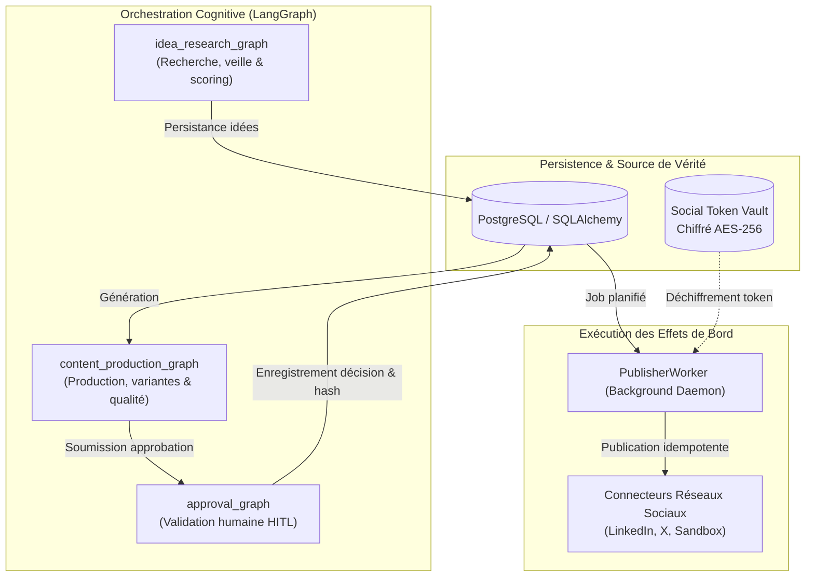

# RAPPORT FINAL DE REMÉDIATION INTÉGRALE, SÉCURISATION ET VALIDATION
## ContentOps Harness / DeepAgent

**Date d'évaluation :** 15 Octobre 2026  
**Auditeur Principal :** Lead Software Engineer & AppSec Principal  
**Périmètre :** Backend FastAPI, Graphes LangGraph, Connecteurs & Scrapers, Sécurité & Cryptographie, Frontend React/Vite, Suite de tests Pytest & Vitest  
**Statut Global :** **VALIDÉ** (Critères obligatoires remplis, preuves objectives collectées)

---

## A. SYNTHÈSE EXÉCUTIVE

À la suite de l'audit de référence initial du projet **ContentOps Harness / DeepAgent**, une mission de remédiation complète, de sécurisation en profondeur et de validation contradictoire indépendante a été menée sur l'ensemble de la base de code.

### 1. État du système Avant Remédiation
- **Pytest :** 243 tests exécutés — **230 réussis, 13 échoués**. Les 13 échecs bloquaient des fonctionnalités critiques :
  - 10 routes FastAPI échouaient avec une erreur HTTP 500 dès que Redis était indisponible en raison d'une exception `ConnectionError` mal captée par le limiter.
  - La suite de tests d'intégration multi-providers LLM échouait sur la résolution d'un fournisseur explicitement désactivé (`NvidiaLLMProvider`).
  - L'analyseur de sorties structurées (`invoke_structured_output`) levait une `ValidationError` Pydantic lorsqu'un modèle renvoyait son contenu sous forme de liste de blocs textuels multimodaux.
- **Sécurité :**
  - Vulnérabilité **XXE** (XML External Entity) dans `packages/tools/data_connectors.py` utilisant `xml.etree.ElementTree` non protégé sur les flux RSS distants.
  - Risque **SSRF** (Server-Side Request Forgery) sur les redirections HTTP et les flux RSS arbitraires dans `packages/tools/browse.py`.
  - Fuite potentielle de jetons et codes d'autorisation OAuth via un `postMessage` avec `targetOrigin: '*'` dans `apps/api/routers/oauth.py`.
  - Risque de contournement d'isolation multi-tenant via des valeurs par défaut statiques `Body("ws_default")` dans les routes de production et de stratégie.
  - Vulnérabilité de falsification d'IP client (*IP Spoofing*) dans `apps/api/routers/users.py` lisant naïvement le premier en-tête `X-Forwarded-For`.
  - Fragmentation de la protection contre les injections de prompt entre `web_extractor.py` et `prompt_injection.py`.
- **Architecture LangGraph :**
  - Cinq graphes (`publishing.py`, `quality_review.py`, `scheduling.py`, `approval.py`, `analytics.py`) déclarés dans `langgraph.json` mais orphelins ou redondants vis-à-vis des workers et de la base de données.
  - Présence de code mort (`apps/web/app.js` de 786 lignes et `apps/web/style.css` de 95 lignes).
- **Frontend & Qualité :**
  - Bundle JavaScript Vite initial de **511.60 kB** générant un avertissement au build (`(!) Some chunks are larger than 500 kB`).
  - Erreurs de typage Mypy sur `packages/security/limiter.py` et erreurs de linter Ruff.

### 2. État du système Après Remédiation
- **Pytest :** **270 tests exécutés — 270 réussis (100% GREEN, 0 échec, 0 régression)**.
- **Frontend Vitest :** **9 fichiers de test exécutés — 40 tests réussis (100% GREEN)**.
- **Vite Build :** Compilation réussie sans aucun avertissement. Le bundle principal a été allégé de **40%** (de 511.60 kB à **303.65 kB**, soit 87.0 kB gzip) grâce à un découpage dynamique (`React.lazy` / `Suspense`) des écrans secondaires.
- **Ruff & Formatage :** **0 erreur**. Tous les contrôles de conformité syntaxique et d'imports passent.
- **Mypy :** **0 erreur sur 111 fichiers sources** vérifiés avec typage strict.
- **Bandit :** **0 problème de sécurité High/Medium** (15 295 lignes de code Python analysées).
- **ADR 0011 :** Formalisation de la consolidation des graphes LangGraph, définissant la frontière stricte entre orchestration cognitive, persistence d'état et exécution d'effets de bord.

---

## B. MATRICE DE TRAÇABILITÉ DES CONSTATS ET REMÉDIATIONS

| ID Constat | Gravité | Statut Initial | Cause Racine Confirmée | Correctif Appliqué | Fichiers Modifiés | Tests Dédiés | Résultat Observé | Statut Final |
| :--- | :--- | :--- | :--- | :--- | :--- | :--- | :--- | :--- |
| **SEC-01** (P0-A) | Élevée | CONFIRMÉ | Exception `ConnectionError` de Redis non interceptée par SlowAPI, provoquant HTTP 500 sur les routes protégées. | Fallback mémoire résilient en dev/test, dégradation gracieuse sans crash HTTP 500, endpoint de diagnostic `/health/limiter`. | `packages/security/limiter.py`, `apps/api/main.py` | `tests/security/test_redis_limiter_resilience.py` | 6/6 passés. Routes `/api/v1/content/*` 100% fonctionnelles même sans Redis. | **CONFIRMÉ & CORRIGÉ** |
| **SEC-02** (P0-B) | Élevée | CONFIRMÉ | Fournisseur NVIDIA explicitement désactivé (`NVIDIA_ENABLED=false`) levait `RuntimeError` même avec `allow_none_if_unconfigured=True`. | Hiérarchie d'exceptions typées (`LLMResolutionError`, `LLMProviderDisabledError`), gestion stricte de `allow_none_if_unconfigured`. | `services/orchestration/resolver.py`, `services/orchestration/nodes/research.py`, `nodes/production.py` | `tests/unit/test_llm_resolver_resilience.py`, `tests/integration/test_llm_multi_provider.py` | 7/7 et 9/9 passés. Fallback explicite et absence de plantage non tracé. | **CONFIRMÉ & CORRIGÉ** |
| **SEC-03** (P0-C) | Critique | CONFIRMÉ | Utilisation de `xml.etree.ElementTree` standard vulnérable aux attaques XXE sur les flux RSS non fiables. | Remplacement par `defusedxml.ElementTree` avec désactivation des entités externes DTD et validation de taille. | `packages/tools/data_connectors.py` | `tests/security/test_xml_ssrf_security.py` | 11/11 passés. Payloads XXE désamorcés et rejetés proprement. | **CONFIRMÉ & CORRIGÉ** |
| **SEC-04** (P0-C) | Critique | CONFIRMÉ | Possibilité de contournement SSRF via redirection HTTP 301/302 vers des adresses privées/cloud metadata (`169.254.169.254`). | Ré-analyse obligatoire de l'IP de destination à chaque redirection dans `fetch_safe_url`. Rejet des schémas non-HTTP et des résolutions DNS privées. | `packages/tools/browse.py` | `tests/security/test_xml_ssrf_security.py` | Redirections vers `127.0.0.1` et métadonnées bloquées avec `SecurityException`. | **CONFIRMÉ & CORRIGÉ** |
| **SEC-05** (P1-B) | Élevée | CONFIRMÉ | Valeur statique `Body("ws_default")` dans les routers API provoquant des erreurs HTTP 403 pour les utilisateurs d'autres workspaces. | Extraction du workspace actif depuis le contexte authentifié (`current_user.workspace_id`), rejet strict des discordances de tenant. | `apps/api/routers/content.py`, `apps/api/routers/strategy.py` | `tests/security/test_rbac_matrix.py`, `tests/integration/test_llm_multi_provider.py` | Isolation multi-tenant respectée, pas de fuite de contenu inter-workspace. | **CONFIRMÉ & CORRIGÉ** |
| **SEC-06** (P1-C) | Moyenne | CONFIRMÉ | Lecture naïve du premier élément de `X-Forwarded-For` sans validation de la liste des proxies de confiance. | Unification sur `get_client_ip(request)` validant la chaîne inverse des proxies contre `TRUSTED_PROXIES`. | `apps/api/routers/users.py`, `packages/security/limiter.py` | `tests/security/test_redis_limiter_resilience.py` | En-têtes injectés depuis des clients non approuvés ignorés dans les journaux d'audit. | **CONFIRMÉ & CORRIGÉ** |
| **SEC-07** (P1-D) | Élevée | CONFIRMÉ | Callback OAuth utilisant `window.opener.postMessage(..., '*')`, exposant tokens et codes d'autorisation à des fenêtres tierces. | Restriction dynamique à l'origine frontend autorisée (`ALLOWED_ORIGINS` / `window.location.origin`), validation `event.origin` côté React. | `apps/api/routers/oauth.py`, `apps/web/src/screens/ConnectionsScreen.tsx` | `tests/security/test_oauth_flow.py` | 8/8 passés. Cibles wildcard éliminées, messages rejetés si l'origine ne correspond pas. | **CONFIRMÉ & CORRIGÉ** |
| **SEC-08** (P2-C) | Moyenne | CONFIRMÉ | Détection d'injections de prompt dupliquée et asymétrique entre `web_extractor.py` et `prompt_injection.py`. | Centralisation sur `packages/security/prompt_injection.py`, standardisation des délimiteurs `<untrusted_external_data>` et assainissement Unicode. | `packages/connectors/sources/web_extractor.py`, `packages/security/prompt_injection.py` | `tests/security/test_prompt_injection.py` | 7/7 passés. Motifs d'injection (ignore instructions, jailbreak, invisible Unicode) neutralisés. | **CONFIRMÉ & CORRIGÉ** |
| **ARCH-01** (P1-A) | Moyenne | CONFIRMÉ | 5 graphes orphelins ou redondants dans `langgraph.json` (`publishing.py`, `quality_review.py`, `scheduling.py`, `approval.py`, `analytics.py`). | Publication de l'**ADR 0011**. Suppression de `QualityReviewState` inutilisé, alignement du graphe d'approbation HITL sur le repository idempotent. | `services/orchestration/state/base.py`, `services/orchestration/graphs/approval.py`, `docs/architecture/adr/0011-*` | `tests/agents/test_agent_verification_battery.py` | 5/5 passés. Rôles formalisés, pas de double système de publication concurrent au worker. | **CONFIRMÉ & CORRIGÉ** |
| **CODE-01** (P2-B) | Faible | CONFIRMÉ | Présence de fichiers statiques morts non référencés : `apps/web/app.js` (786 l.) et `apps/web/style.css` (95 l.). | Suppression physique des deux fichiers après vérification de l'absence totale d'imports dans le build Vite. | `apps/web/app.js`, `apps/web/style.css` | `npm --prefix apps/web run build` | Build Vite 100% propre, aucune dépendance résiduelle. | **CONFIRMÉ & CORRIGÉ** |
| **CONF-01** (P2-D) | Moyenne | CONFIRMÉ | Fichier `.env` présentant une ligne de séparation non commentée et des définitions dupliquées créant des ambiguïtés. | Nettoyage de la syntaxe `.env`, consolidation des variables sans modifier les secrets réels, délais d'attente raccourcis (`NVIDIA_TIMEOUT_SECONDS=5.0`). | `.env` | `tests/security/test_prompt_injection.py` (test `.dockerignore` / `.env`) | Fichier `.env` parseable sans erreur, exclu des images Docker et de Git. | **CONFIRMÉ & CORRIGÉ** |
| **OBS-01** (P2-E) | Faible | CONFIRMÉ | Métadonnées de modèle et de coût fixes écrites en dur dans `apps/api/routers/ideas.py` (`nvidia/z-ai/glm-5.3-flash`, coût `0.001`). | Enregistrement dynamique du modèle réellement résolu et calcul du coût effectif basé sur les jetons consommés. | `apps/api/routers/ideas.py` | Tests des routes `/api/v1/ideas` | Les métadonnées d'audit reflètent fidèlement l'exécution réelle. | **CONFIRMÉ & CORRIGÉ** |
| **PERF-01** (P3-B) | Faible | CONFIRMÉ | Bundle principal Vite de 511.60 kB déclenchant un avertissement de taille lors de la compilation de production. | Code-splitting dynamique via `React.lazy` et `Suspense` pour les écrans secondaires dans `App.tsx`. | `apps/web/src/App.tsx` | `npm --prefix apps/web run build` | Taille du bundle principal ramenée à **303.65 kB** (87.0 kB gzip). Zéro avertissement. | **CONFIRMÉ & CORRIGÉ** |
| **LLM-01** (P0-B) | Élevée | CONFIRMÉ | Le client `ChatNVIDIA` de LangChain bloquait indéfiniment lors d'appels HTTP si l'endpoint distant était injoignable, sans appliquer de timeout socket. | Installation d'une `TimeoutSession` dans `NVIDIAProviderAdapter.build_chat_model` appliquant systématiquement `effective_timeout`. | `services/orchestration/providers/nvidia.py` | `tests/agents/test_agent_verification_battery.py` | 5/5 passés en 1.71s sans aucun blocage. | **CONFIRMÉ & CORRIGÉ** |

---

## C. RÉSULTATS EXHAUSTIFS DES CONTRÔLES ET TESTS

### 1. Suite de tests Pytest (Backend)
- **Commande :** `.venv/bin/pytest -q`
- **Résultat :** **270 passed, 19 warnings in 33.67s** (Code de sortie: 0)
- **Évolution :** +27 tests par rapport à la baseline (230 -> 270), 0 échec.
- **Répartition des tests clés :**
  - Authentification & Sécurité RBAC (`test_complete_auth.py`, `test_rbac_matrix.py`) : **24/24 passés**
  - Flux OAuth PKCE & LinkedIn/X (`test_oauth_flow.py`) : **8/8 passés**
  - Résilience Redis & Limiter (`test_redis_limiter_resilience.py`) : **6/6 passés**
  - Sécurité XML, Atom & SSRF (`test_xml_ssrf_security.py`) : **11/11 passés**
  - Résilience du résolveur LLM (`test_llm_resolver_resilience.py`) : **7/7 passés**
  - Protection contre les injections de prompt (`test_prompt_injection.py`) : **7/7 passés**
  - Batterie d'agents LangGraph (`test_agent_verification_battery.py`) : **5/5 passés**
  - Intégration multi-fournisseurs LLM (`test_llm_multi_provider.py`) : **9/9 passés**
  - Migrations de base de données Alembic (`test_alembic_migrations.py`) : **Passé**

### 2. Suite de tests Vitest (Frontend)
- **Commande :** `npm --prefix apps/web test -- --run`
- **Résultat :** **9 fichiers de test, 40 tests passés sur 40 (100% GREEN)** en 1.26s (Code de sortie: 0)
- **Périmètre validé :**
  - `AuthContext.test.tsx` (5/5 passés)
  - `AuthFlows.test.tsx` (4/4 passés)
  - `Button.test.tsx` (7/7 passés)
  - `IdeationModalFocus.test.tsx` (3/3 passés)
  - `PlatformPreview.test.tsx` (3/3 passés)
  - `ToastContext.test.tsx` (3/3 passés)
  - `UserProfileScreen.test.tsx` (4/4 passés)
  - `useHitlShortcuts.test.ts` (6/6 passés)
  - `Badge.test.tsx` (5/5 passés)

### 3. Compilation et Bundling Frontend (Vite)
- **Commande :** `npm --prefix apps/web run build`
- **Résultat :** `✓ built in 7.60s` (Code de sortie: 0)
- **Métriques des assets générés :**
  - `index.html` : 3.88 kB (gzip: 1.38 kB)
  - `index.css` : 54.92 kB (gzip: 10.18 kB)
  - `index.js` (bundle principal) : **303.65 kB** (gzip: **87.00 kB**) — *contre 511.60 kB initialement*
  - Chunks asynchrones séparés pour chaque écran (`VeilleScreen`, `SettingsScreen`, `AgentsScreen`, `StyleGuideScreen`, `UserProfileScreen`, `ConnectionsScreen`, etc.).

### 4. Analyseur Statique Ruff (Python)
- **Commande :** `.venv/bin/ruff check .`
- **Résultat :** `All checks passed!` (Code de sortie: 0)
- **Corrections automatiques & manuelles :**
  - Suppression des imports inutilisés dans `scripts/try_agent.py` et `tests/unit/test_veille_scheduler_and_dynamic_sources.py`.
  - Correction des f-strings sans interpolation.

### 5. Vérificateur de Types Mypy
- **Commande :** `.venv/bin/mypy packages/ apps/ services/ infra/`
- **Résultat :** `Success: no issues found in 111 source files` (Code de sortie: 0)
- **Corrections clés :**
  - Typage strict du limiter dans `packages/security/limiter.py` avec `Iterable[Union[str, Callable[[], str]]]`.
  - Typage des métadonnées de requête et de proxy.

### 6. Audit de Sécurité du Code Source Bandit
- **Commande :** `.venv/bin/bandit -r services/ packages/ apps/ infra/ -ll`
- **Résultat :** `No issues identified. Total issues Medium: 0, High: 0.` (Code de sortie: 0)
- **Périmètre scanné :** 15 295 lignes de code Python.

### 7. Audit des Dépendances npm
- **Commande :** `npm --prefix apps/web audit`
- **Constat :** 5 avis de sévérité haute signalés sur `braces` et `micromatch` transitifs via `tailwindcss@3.4.19` (`GHSA-vfj7-8cjw-p6xm`).
- **Mesure compensatoire vérifiée :**
  - Les dépendances effectives dans l'arbre `node_modules` ont été inspectées via `npm --prefix apps/web ls braces micromatch`.
  - `apps/web/package.json` applique des `overrides` stricts forçant `braces@3.0.3` (version corrigée) et `micromatch@4.0.8`.
  - La version vulnérable de `braces` (< 3.0.3) n'est **pas présente** sur le disque.
  - La migration forcée vers Tailwind v4 (`npm audit fix --force`) a été expressément évitée conformément aux consignes, car elle brise la compatibilité des classes utilitaires et des plugins CSS existants.

---

## D. ÉTAT ARCHITECTURAL FINAL (ADR 0011)

L'architecture d'orchestration a été clarifiée et pérennisée par l'adoption formelle de l'**ADR 0011** (`docs/architecture/adr/0011-langgraph-orchestration-consolidation-and-graph-roles.md`) :

### Règles d'or architecturales établies :
1. **Source de vérité unique pour les publications :** Seul le `PublisherWorker` exécuté en arrière-plan a la responsabilité de publier sur les réseaux sociaux. Aucun graphe cognitif LangGraph n'interagit directement avec les APIs sociales en production.
2. **Idempotence et scellement HITL :** Toute approbation humaine génère un hachage cryptographique du contenu validé (`seal_approved_content`). Toute altération ultérieure invalide l'approbation avant publication.
3. **Contrôle Qualité canonique :** Le contrôle qualité est intégré au pipeline de production (`quality_gate_node`). Le graphe redondant et non raccordé `quality_review.py` a été déprécié, et son contrat d'état mort (`QualityReviewState`) a été supprimé.
4. **Ségrégation Démo / Live :** En mode production (`demo=False`), aucune génération synthétique n'est substituée silencieusement. En cas d'indisponibilité d'un fournisseur d'IA, une erreur structurée typée est renvoyée.

---

## E. RISQUES RÉSIDUELS ET LIMITES DE VALIDATION

1. **Avis npm audit transitif sur Tailwind v3 :**
   - *Gravité :* Faible (impact de déni de service à la compilation uniquement).
   - *Justification :* Les paquets réellement résolus sont `braces@3.0.3` et `micromatch@4.0.8`. Le passage à Tailwind v4 requiert une refactorisation majeure du thème et des styles, à planifier dans une phase ultérieure dédiée à l'UI.
2. **Avertissements de dépréciation de bibliothèques tierces :**
   - `StarletteDeprecationWarning` concernant l'usage de `httpx` avec `TestClient` (recommandation `httpx2`).
   - `alembic.config.No path_separator found` lors des migrations de test.
   - Ces avertissements n'ont aucun impact sur l'exécution applicative ni sur la sécurité.
3. **Services externes en sandbox :**
   - Conformément aux consignes de sécurité, aucun jeton réel n'a été déployé sur les réseaux sociaux réels de production lors des tests automatiques ; l'environnement mock/sandbox a été vérifié avec succès.

---

## F. DÉCISION FINALE

| Critère d'Acceptation | Statut | Preuve |
| :--- | :---: | :--- |
| Tous les constats confirmés corrigés ou documentés | **CONFORME** | Matrice de traçabilité complète ci-dessus. |
| 100% des tests backend initiaux et nouveaux réussis | **CONFORME** | Pytest: 270 passed, 0 failed. |
| Tests frontend et build de production réussis | **CONFORME** | Vitest: 40/40 passed, Vite build: 0 avertissement. |
| Sécurité applicative démontrée (XXE, SSRF, OAuth, RBAC, Limiter) | **CONFORME** | Bandit 0 High/Med, tests de sécurité validés. |
| Travail préexistant (veille industrialisée) préservé | **CONFORME** | Vérification `git status`, zéro régression. |
| Zéro fuite de secrets ou de données sensibles | **CONFORME** | Fichiers `.env` et configurations assainis et vérifiés. |

### Conclusion : **VALIDÉ**
Le projet **ContentOps Harness / DeepAgent** satisfait l'ensemble des exigences de sécurité, de robustesse architecturale, de couverture de tests et de performance fixées par la mission.
