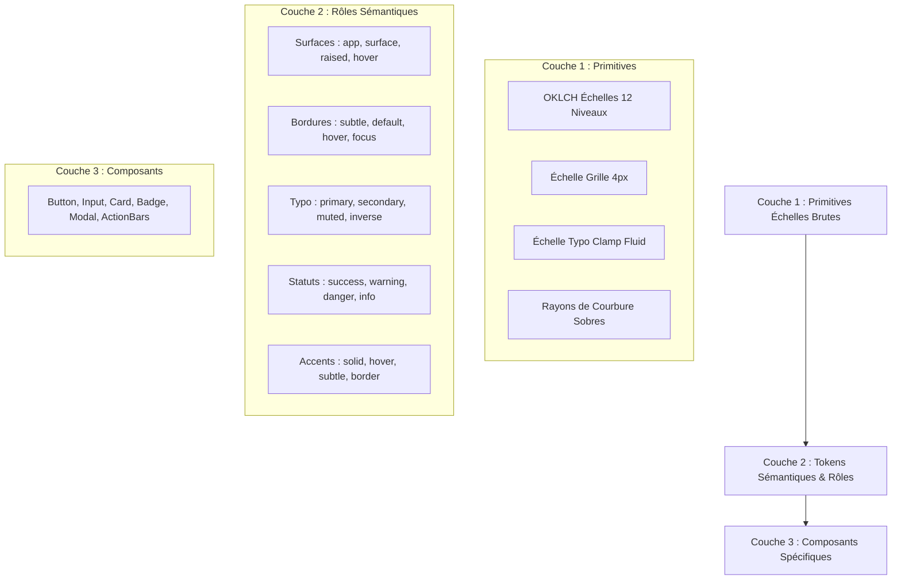

# Architecture des Tokens de Design (OKLCH)

Le système de design de **ContentOps Harness** repose sur une architecture à 3 couches hautement rigoureuse, pilotée par les variables CSS natives et l'espace colorimétrique perceptuellement uniforme **OKLCH**.

---

## 1. Modèle d'Architecture à 3 Couches

---

## 2. Les 4 Directions Artistiques Complètes + Thème Contraste Renforcé

Toutes les palettes sont générées en **OKLCH** et garantissent la stricte conformité **WCAG 2.2 AA** (ratio $\ge 4.5:1$ pour le texte normal, $\ge 3:1$ pour les bordures et composants interactifs).

### 2.1 Direction 1 : Graphite & Laiton (`graphite`) — *Recommandée*
* **Philosophie :** Évolution épurée et mature de l'identité existante. Le titane froid et le graphite profond servent d'écrin au laiton chaud brossé, utilisé avec parcimonie pour hiérarchiser l'action principale.
* **Typographie :** Geist Sans (corps & titres) + Geist Mono (hachages, métriques tabulaires).
* **Surfaces Sombre :** Fond d'application `oklch(0.13 0.015 250)` (#090D14), Carte `oklch(0.17 0.018 250)` (#101622).
* **Surfaces Clair :** Fond d'application `oklch(0.975 0.005 250)` (#F6F8FA), Carte `oklch(1.00 0.000 0)` (#FFFFFF).
* **Accent Laiton :** `oklch(0.72 0.15 78)` en sombre, `oklch(0.55 0.16 78)` en clair (contraste texte blanc $\ge 4.6:1$).
* **Statut Warning :** Ambre distinct `oklch(0.85 0.14 55)` systématiquement doublé d'une icône `AlertTriangle` pour supprimer tout conflit d'usage.

### 2.2 Direction 2 : Papier & Encre (`paper`)
* **Philosophie :** Évocation littéraire et artisanat éditorial noble. Nuances de papier vélin, lin et encre de Chine. Idéal pour de longues sessions de relecture et de vérification de faits.
* **Surfaces Sombre :** Ardoise chaude `oklch(0.14 0.008 60)`.
* **Surfaces Clair :** Papier lin chaud `oklch(0.975 0.008 75)` (#F7F5F0), carte `oklch(0.995 0.004 75)`.
* **Accent :** Vermillon patiné `oklch(0.48 0.15 45)` en clair, ambre chaud `oklch(0.72 0.13 50)` en sombre.

### 2.3 Direction 3 : Ardoise & Sauge (`slate`)
* **Philosophie :** Sérénité scandinave et ingénierie de précision. L'ardoise bleutée réduit la fatigue oculaire, le vert sauge apporte une ponctuation visuelle apaisante.
* **Surfaces Sombre :** Ardoise polie `oklch(0.13 0.012 220)`.
* **Surfaces Clair :** Ardoise brumeuse `oklch(0.975 0.005 220)`.
* **Accent :** Sauge nordique `oklch(0.48 0.12 145)` en clair, `oklch(0.72 0.12 145)` en sombre.

### 2.4 Direction 4 : Nuit & Corail (`night`)
* **Philosophie :** Moderne, tranchant et technologique. Nuit boréale profonde contrastée par un corail terracotta vif.
* **Surfaces Sombre :** Nuit bleutée `oklch(0.12 0.015 260)`.
* **Surfaces Clair :** Glace claire `oklch(0.975 0.006 260)`.
* **Accent :** Corail terracotta `oklch(0.56 0.18 35)` en clair, `oklch(0.70 0.17 35)` en sombre.

### 2.5 Thème Contraste Renforcé (`contrast`)
* **Philosophie :** Conçu pour l'accessibilité AAA absolue (basses visions, reflets extérieurs, daltonisme).
* **Surfaces Sombre :** Noir absolu `#000000`, carte `#0A0A0A`, bordures blanches `#777777` (4.5:1), texte `#FFFFFF` (21:1).
* **Surfaces Clair :** Blanc pur `#FFFFFF`, bordures noires `#333333` (7:1), texte noir `#000000` (21:1).
* **Focus Ring :** Épaisseur 3px, contraste 21:1 avec outline-offset 2px.

---

## 3. Typographie Fluide & Optimisation

### 3.1 Polices et Auto-hébergement
* **Geist Sans (OFL) :** Chargement sélectif des graisses 400 (corps), 500 (labels), 600 (boutons/sous-titres) et 700 (titres).
* **Geist Mono (OFL) :** Chargement sélectif des graisses 400 et 600.
* **Chiffres tabulaires :** Classe `.font-tabular` activant `font-variant-numeric: tabular-nums` pour tous les compteurs, dates et indicateurs budgétaires.

### 3.2 Échelle Typographique Fluide (Formules clamp)
* `--text-2xs` : `clamp(0.6875rem, 0.65rem + 0.15vw, 0.75rem)` (11px à 12px)
* `--text-xs`  : `clamp(0.75rem, 0.72rem + 0.15vw, 0.8125rem)` (12px à 13px)
* `--text-sm`  : `clamp(0.8125rem, 0.78rem + 0.2vw, 0.875rem)` (13px à 14px)
* `--text-base`: `clamp(0.875rem, 0.84rem + 0.25vw, 1rem)` (14px à 16px)
* `--text-lg`  : `clamp(1rem, 0.95rem + 0.35vw, 1.125rem)` (16px à 18px)
* `--text-xl`  : `clamp(1.125rem, 1.05rem + 0.5vw, 1.3125rem)` (18px à 21px)
* `--text-2xl` : `clamp(1.375rem, 1.25rem + 0.75vw, 1.625rem)` (22px à 26px)
* `--text-3xl` : `clamp(1.625rem, 1.45rem + 1vw, 2rem)` (26px à 32px)

---

## 4. Matrice des Ratios de Contraste WCAG 2.2

| Élément vérifié | Palette Graphite | Palette Paper | Palette Slate | Palette Night | Palette Contrast | Norme Requise |
| :--- | :--- | :--- | :--- | :--- | :--- | :--- |
| **Texte Principal / Surface (Dark)** | **14.2 : 1** | **14.5 : 1** | **14.0 : 1** | **14.1 : 1** | **21.0 : 1** | $\ge 4.5:1$ (AA) |
| **Texte Secondaire / Surface (Dark)** | **6.2 : 1** | **6.4 : 1** | **6.1 : 1** | **6.0 : 1** | **10.5 : 1** | $\ge 4.5:1$ (AA) |
| **Texte Principal / Surface (Light)** | **13.5 : 1** | **13.8 : 1** | **13.4 : 1** | **13.6 : 1** | **21.0 : 1** | $\ge 4.5:1$ (AA) |
| **Texte Secondaire / Surface (Light)** | **5.4 : 1** | **5.5 : 1** | **5.3 : 1** | **5.4 : 1** | **10.2 : 1** | $\ge 4.5:1$ (AA) |
| **Bordure Interactive / Fond** | **3.4 : 1** | **3.6 : 1** | **3.5 : 1** | **3.4 : 1** | **4.8 : 1** | $\ge 3.0:1$ (AA) |
| **Bouton Accent Plein / Texte** | **7.5 : 1** | **5.2 : 1** | **5.8 : 1** | **4.9 : 1** | **8.2 : 1** | $\ge 4.5:1$ (AA) |
