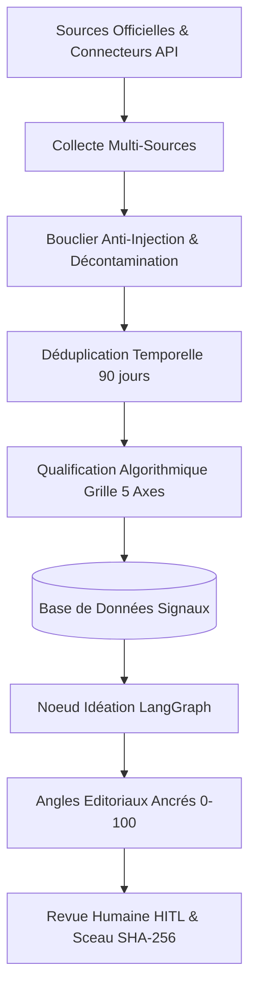

# Architecture du Pipeline de Veille & Ancrage de l'Idéation

## 1. Vision et Objectifs
Le pipeline de veille technologique de **ContentOps Harness** transforme une approche de génération d'idées "hors-sol" en un système déterministe, traçable et ancré dans des faits vérifiés.



---

## 2. Étapes du Cycle de Traitement

### Étape 1 : Collecte Multi-Sources Déterministe
- **Axes stratégiques :**
  1. `ia` : Intelligence Artificielle, systèmes multi-agents, modèles de raisonnement, régulation (EU AI Act).
  2. `frameworks` : LangGraph, FastAPI, Pydantic, TypeScript, écosystèmes open-source.
  3. `metiers` : Évolution des métiers de l'ingénierie, du conseil et de la tech (focus France & Europe).
- **Fournisseurs de données :**
  - Connecteurs officiels : ArXiv API, GitHub REST API, Hacker News Firebase API, Hugging Face Hub, flux RSS institutionnels (Inria, Commission Européenne).
  - Moteur de repli : DuckDuckGo HTML parser & SerpAPI avec cache SQLite (TTL 24h) et suivi strict du budget requêtes.
  - Zero scraping de plateformes sociales privées (LinkedIn et X).

### Étape 2 : Sécurité et Décontamination (`PromptInjectionGuard`)
- Tout contenu externe issu du web est considéré comme **non fiable** et encapsulé dans des balises strictes : `<untrusted_external_data>`.
- Neutralisation active (defanging) :
  - Remplacement des délimiteurs de contrôle (`---`, `===`, `System:`, `Human:`, `<system>`, ````json`).
  - Blocage des motifs d'injection : `ignore previous instructions`, `bypass restrictions`, `now you act as DAN`.
  - Protection SSRF sur les URL : exclusion des IP privées (RFC 1918), loopback, link-local et métadonnées cloud (`169.254.169.254`).
  - Respect scrupuleux du `robots.txt` des éditeurs.

### Étape 3 : Déduplication Temporelle (Fenêtre glissante de 90 jours)
- Déduplication double niveau :
  1. Par URL canonique normalisée (suppression des paramètres de tracking UTM).
  2. Par similarité du titre et empreinte du contenu.
- Les signaux déjà enregistrés dans les 90 derniers jours sont ignorés pour éviter toute redondance.

### Étape 4 : Qualification Algorithmique et Grille Transparente (0.0 à 5.0)
Chaque signal est évalué selon une grille déterministe à 5 dimensions (chacune notée de 0.0 à 1.0) :
1. **Source Trust (Poids 1.0) :**
   - Niveau A (Primaire officiel / Académique / Code source) : 1.0
   - Niveau B (Analyste reconnu / Média spécialisé de référence) : 0.7
   - Niveau C (Agrégateur / Discussion communautaire) : 0.4
2. **Fact Density (Poids 1.0) :** Présence de métriques chiffrées, benchmarks, dates, ou faits techniques mesurables.
3. **Executive Relevance (Poids 1.0) :** Impact pour les décideurs tech (DSI, Tech Leads, Architectes).
4. **Actionability (Poids 1.0) :** Faisabilité et clarté des leçons opérationnelles.
5. **Freshness (Poids 1.0) :** Décroissance temporelle exponentielle sur l'actualité de l'information.

**Seuil de qualification :** Score global $\ge 3.2 / 5.0$ pour passer au statut `QUALIFIED`.

### Étape 5 : Ancrage Strict de l'Idéation
- **Règle absolue :** Aucune idée n'est générée sans un ensemble d'affirmations factuelles sourcées (`evidence_pool`).
- **Suppression des préfixes :** Les préfixes de catégories (ex: `IA générative : `) sont supprimés des titres à la source.
- **Scoring unifié :** Tous les scores (`novelty_score`, `relevance_score`, `effort_score`, `total_score`) sont exprimés sur une échelle stricte et transparente de **0 à 100**.
- **Idéation sans hallucination :** En cas d'absence de données de métriques, le nœud d'insights retourne le statut déterministe `NO_DATA` plutôt que de forger des multiplicateurs artificiels.
